<div align="center">

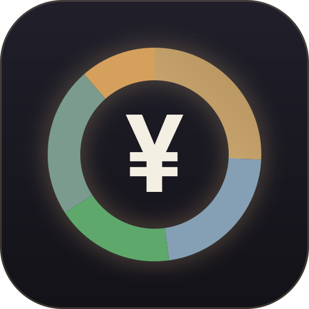

# licai

**A self-hosted personal asset dashboard and market analysis tool**

China A-shares · HK/US stocks · funds · bank wealth products · cash · digital assets · trading bots in one dashboard;<br>
plus a market Q&A agent, a background watcher, market-wide rankings, sector and sentiment analysis, and performance review

[](https://github.com/SnowWarri0r/licai/releases) [](./LICENSE) [](https://github.com/SnowWarri0r/licai/stargazers) [](https://github.com/SnowWarri0r/licai/commits/main)

[](https://www.python.org/) [](https://fastapi.tiangolo.com/) [](https://react.dev/) [](https://www.sqlite.org/) [](#tech-stack)

All data lives in a single SQLite file on your own machine. No cloud, no accounts.<br>
Everything it outputs is objective information and structural description. It never gives buy or sell advice.

[中文](./README.md) · **English**

<a href="#quick-start"><b>Quick start</b></a> · <a href="#features"><b>Features</b></a> · <a href="#market-qa-agent"><b>Q&A agent</b></a> · <a href="#watcher"><b>Watcher</b></a> · <a href="#optional-integrations"><b>Integrations</b></a> · <a href="#scope-and-disclaimer"><b>Disclaimer</b></a>

</div>

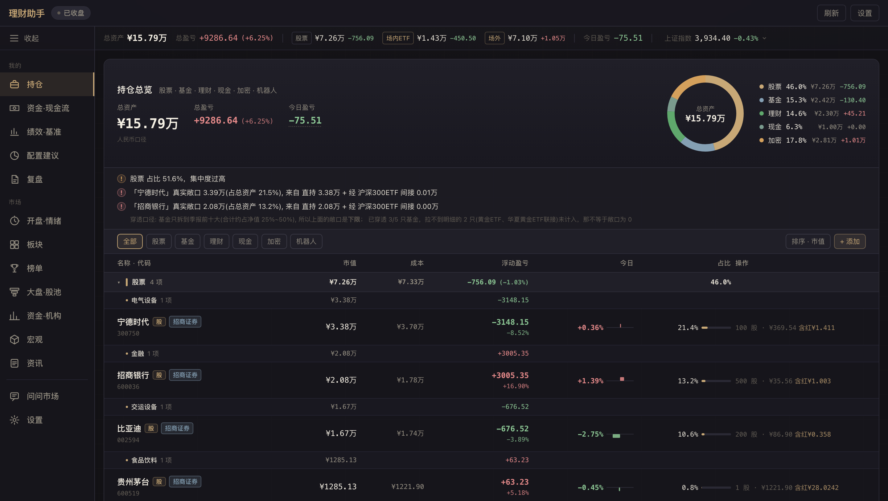

> Screenshots use demo data; reproduce them with `python scripts/seed_demo.py --use`.

> **About language**: the interface, agent output and most data sources (Chinese exchanges, brokers and news outlets) are in Chinese. The project targets investors in the China A-share market; HK and US stocks are supported as additional markets.

## Why

Broker and bank apps only show the assets held on their own platform, so consolidating across platforms is manual work; spreadsheets lack market data and analysis. licai brings positions from every platform into one interface, computes cost, P&L and risk exposure with consistent conventions, and adds market data and review tools on top.

Three design principles:

- **Local first**: quotes come from public endpoints; ledgers, credentials and settings stay in local SQLite.
- **Verifiable numbers**: cost, fees and NAV estimates follow broker and fund-platform conventions. Statistics that depend on samples report their coverage and withhold conclusions when coverage is insufficient.
- **Facts only**: user-facing text, LLM output and alerts are limited to objective information and historical statistics; directional decisions are left to the user.

## Quick start

```bash
git clone https://github.com/SnowWarri0r/licai
cd licai

# Backend
python3 -m venv venv && source venv/bin/activate
pip install -r requirements.txt
cp config.example.py config.py      # adjust commission_rate / commission_min etc. as needed

# Frontend
cd frontend && npm install && npm run build && cd ..

# Run
python run.py                       # open http://localhost:8888
```

The first start creates an empty `portfolio.db` in the project root. Always start with the Python inside `venv`: optional plugins are loaded through that environment's entry points.

**Demo data**

```bash
python scripts/seed_demo.py --use       # back up the current DB and load demo data; restart the server
python scripts/seed_demo.py --restore   # restore the original DB
python scripts/seed_demo.py --peek      # only write portfolio.demo.db, leave the current DB alone
```

**Start at login (macOS)**

```bash
./install.sh    # generates a launchd config from com.licai.plist.example and registers it; logs go to logs/
```

**LAN access**

The server listens on `0.0.0.0:8888` by default. Other devices on the same network can open `http://<host IP>:8888`. To prevent DNS rebinding, only IP addresses and `localhost` are accepted as the Host.

## Features

The sidebar is split by one question: does it concern my own money or not. The Q&A agent and settings sit at the bottom; the watcher opens from the top bar.

| Group | Page | Contents |
|---|---|---|
| Mine | Holdings | [Unified dashboard](#unified-dashboard), trade history, entry forms, trade plans |
| | Cash flow | Monthly income, spending, net savings and disposable budget |
| | Performance | Benchmark comparison, [sector radar](#sectors-and-sentiment), [equity curve](#review), holding correlation |
| | Allocation | [Template allocation gaps](#allocation), A-share sector gaps, ETF exposure |
| | Review | [Daily / weekly / monthly / overall review](#review), close summary, market overview at close, [entry review](#entry-review) |
| Market | Open & sentiment | [Morning briefing](#morning-briefing-and-close-summary), sentiment gauge and sentiment cycle |
| | Sectors | Sector turnover share, trend matrix, sector momentum, [ETF theme X-ray](#etf-theme-x-ray) |
| | Rankings | [Nine-tab market rankings](#market-rankings), concept rotation board, K-line overlay |
| | Market & pools | Next-day performance of limit-up stocks, consecutive-limit ladder, daily lists from analyzer plugins |
| | Institutions | Quarterly institutional sector changes and hot themes (needs an [extension data source](#extension-data-sources-provider)) |
| | Macro | 11 groups: global indices, AI compute, FX, metals, energy and chemicals, agriculture, etc. |
| | News | [Five-source news feed with AI commentary](#news-and-event-calendar) |
| Bottom | Ask the market | [Market Q&A agent](#market-qa-agent) |
| | Settings | Feishu push, local proxy, exchange credentials, LLM config, Knowledge Planet, extension data source, AI reading rules, user memory |

Pages use hash routes (e.g. `#portfolio`, `#rankings`) that can be bookmarked or shared.

## Assets and ledger

<h3 id="unified-dashboard">Unified dashboard</h3>

| Class | Pricing and conventions |
|---|---|
| A-shares | Real-time quotes; total cost includes commission, stamp duty and transfer fee, matching broker apps |
| HK/US stocks | Real-time quotes, daily K-lines and intraday charts; booked at the trade-date FX rate and aggregated in CNY; handles splits and reverse splits, fractional US shares and dividend withholding tax |
| Funds | Exchange-traded ETFs at market price with broker commission; OTC funds at official NAV with T+1 confirmation; redemption fees deducted FIFO by holding period |
| Wealth products | Bank fixed-term products, estimated from annualized yield and start date |
| Cash | Money-market funds and demand deposits, with optional monthly interest estimate |
| Digital assets | Exchange spot prices in real time |
| Bots | Exchange grid / DCA bots with P&L synced automatically |

Ledger conventions:

- **Automatic split handling**: split factors are detected by comparing raw and forward-adjusted daily K-lines; shares × N, price ÷ N, no P&L impact.
- **Diluted cost**: realized P&L from partial sells is folded into the remaining cost and resets after a full exit, matching broker apps.
- **Fill merging**: multiple fills of one order count as one decision, judged by price ticks; see the [data-source notes](docs/data-source-notes.md#一次委托的分笔成交).
- **Multiple brokers**: each trade records its broker and uses that broker's fee schedule; trade time can be recorded to the minute.

The dashboard also provides class and sub-class pie charts, concentration warnings, [look-through exposure](#risk-indicators), and four ways to add a position (by shares, amount + NAV, amount + units, pending confirmation).

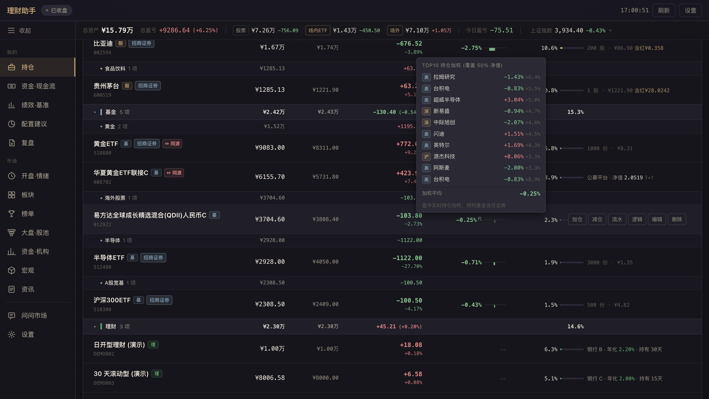

**Trade plans**: after the close, set price levels for the next day; when a level is hit intraday the page shows it (and Feishu if configured), and after the close the plan is compared with actual fills.

<h3 id="otc-fund-nav-estimates">Intraday estimates for OTC funds</h3>

OTC fund NAVs are published at T+1, so intraday values have to be estimated. licai uses two layers:

1. **Top-10 weighting**: weight the real-time moves of the fund's top-10 quarterly holdings and report the share of NAV they cover.
2. **Regression**: for each fund, fit a ridge regression over its latest 120 NAV days against a set of indices and ETFs (CSI 300, CSI 1000, ChiNext, STAR 50, Hang Seng, Hang Seng Tech, Nasdaq-100, S&P 500, PHLX Semiconductor, SGE gold) plus the top-10 weighting itself. It replaces layer 1 once enough history exists.

Offline evaluation over the latest 180 NAV days (mean absolute error of daily change, percentage points):

| Fund type | Top-10 weighting | Regression |
|---|---|---|
| S&P 500 index QDII | 0.61 | 0.08 |
| Nasdaq-100 index QDII | 0.69 | 0.12 |
| Active IT fund | ~0.98 | ~0.62 |
| Active global tech QDII | 0.8–1.2 | 0.45–0.85 |
| Gold feeder fund | 0.25 | 0.26 |

Pending NAV days follow the A-share calendar: on days when A-shares are closed but HK/US markets trade, the moves roll into the next NAV day. Intraday, today's live bar is added for A-share and HK index factors and SGE gold. Models are cached in `data/fund_nav_model.json`; if fitting fails the top-10 weighting is used.


<h3 id="allocation">Allocation</h3>

Three templates (conservative / balanced / aggressive) across four total-asset tiers (< ¥300k, ¥300k–1M, ¥1M–5M, > ¥5M). Overseas allocation carries fixed costs (account opening, FX conversion, minimum ticket sizes), so its weight rises with asset size. ETFs and QDII funds are mapped to 10 buckets by their underlying assets, and the page shows the gap between current and target weights. The ¥300k–1M tier:

| Template | Cash | Wealth | Bond funds | A-shares | HK | US | Other overseas | Commodities | Crypto |
|---|---|---|---|---|---|---|---|---|---|
| Conservative | 21% | 42% | 16% | 10% | 1% | 5% | 0% | 5% | 0% |
| Balanced | 22% | 25% | 8% | 20% | 3% | 10% | 2% | 6% | 4% |
| Aggressive | 22% | 8% | 5% | 28% | 4% | 14% | 2% | 7% | 10% |

Template constraints live in `TEMPLATE_MATRIX` in `AllocationAdvisor.jsx`: conservative keeps cash + wealth + bond funds ≥ 60%; balanced splits equity and defensive assets evenly; aggressive keeps equity + crypto ≥ 70%.

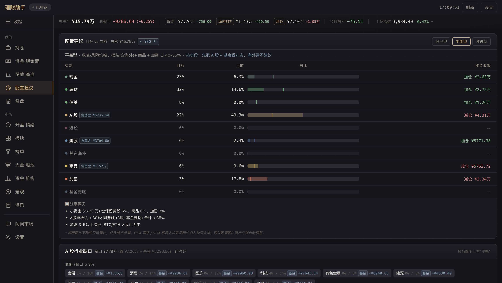

<h3 id="risk-indicators">Risk indicators</h3>

Risk indicators are objective measures only; they produce no trading signals.

- **Portfolio volatility**: for A-shares, ETFs and OTC funds, an EWMA covariance over each holding's last 250 trading days gives the 95% worst-case loss for the next trading day and the next 5 trading days, plus each holding's contribution to portfolio variance. A rolling backtest fixes today's holdings and estimates each past day using only earlier data; the share of days exceeding the estimate should be close to 5%. Crypto and grid bots cannot be aligned to the A-share calendar and are listed separately.
- **Look-through exposure**: funds and ETFs are expanded into their top-10 quarterly holdings, merged with directly held stocks, then grouped by industry. This reveals overlaps that names hide, such as two funds with heavily overlapping top-10 lists, or one stock held indirectly through several QDII funds.
  - A and C share classes of the same fund are merged.
  - Top-10 holdings cover only part of NAV, so the result is a lower bound; funds without holdings detail are listed separately rather than counted as zero.
  - The "same source" badge on holding rows uses the look-through industry; rows below 0.5% of total assets are not badged.
  - A past date can be inspected with `?as_of=YYYY-MM-DD`: A-shares are replayed from the ledger to that day, while funds, wealth products and cash use the nearest snapshot on or before it. The data dates used are reported in `basis`.
  - The dashboard banner, `/api/portfolio/exposure` and the agent's `get_exposure` tool share one implementation.
- **Concentration**: warns when a single sector exceeds 50% / 70%.
- **Fundamental health**: red / yellow flags.

The correlation matrix measures statistical co-movement; look-through exposure measures structural overlap in the underlying holdings.

## Market

<h3 id="market-rankings">Market rankings</h3>

The rankings page shows a list on the left and a K-line panel on the right; `↑` `↓` move between stocks and `←` `→` switch tabs. The search box accepts codes, names and substrings and can open any stock.

| Tab | Contents |
|---|---|
| Watchlist | User-defined groups, a stock can belong to several; today's change, change since added, K-line structure, earnings previews |
| Order-book events | 22 types of exchange order-book events, refreshed every 60 s intraday |
| Gainers | Sorted by gain as a share of the stock's daily limit, so 10% and 20% limit boards compare fairly; with rotation board |
| Turnover | Ranked by turnover; with rotation board |
| Dragon-tiger list | All stocks on the latest exchange disclosure, expandable to the top-5 buy and sell seats |
| Coiled / strong | Leaders with intact structure, grouped by industry |
| Institutions | Institutional seat activity over the last 30 days |
| Earnings | Latest earnings previews, marked against holdings |
| Popularity | Market-wide attention ranking, holdings marked |

<details>
<summary><b>Watchlist</b></summary>

- Groups are top-level views: All / Holdings / user groups / Default.
- "Default" is a real group: starring a stock puts it there, and a stock removed from its last group falls back to it. Batch operations keep at most 8 groups per stock.
- Each group keeps its own order, adjustable by drag and drop.
- Holdings join automatically as a virtual group showing unrealized P&L and days held; they disappear after a full exit.
- **Batch edit**: select several stocks (Shift for ranges), then add to a group, move to a group, remove from this group or remove from the watchlist, done in one backend transaction.
- **Batch add**: paste text and it extracts A-share and exchange-fund codes (with or without `sh`, `.SZ` style affixes), HK codes, US tickers and full stock names. Uncertain entries show candidates to pick from; confirmed stocks are added to the chosen group in one step. Stocks already in the watchlist keep their original add date and price.

</details>

<details>
<summary><b>Concept rotation board</b></summary>

A persistent panel above the gainers and turnover tabs that clusters ranked stocks by concept, showing where money is moving between themes.

- One row per concept: stocks ranked and at limit-up, turnover, average gain, five-day turnover-share trend, change versus the previous day, and leading stocks.
- Click a concept to filter the list; the panel can collapse into a one-line summary.
- Conclusions use turnover share rather than absolute turnover, so they stay comparable when the whole market's volume rises.
- **Tag cleaning**: market-wide tags such as margin-trading eligibility, index membership and region are removed; industry-chain and supplier concepts are kept.
- **Synonym merging**: concepts with heavily overlapping constituents are merged by Jaccard similarity; see the [data-source notes](docs/data-source-notes.md#概念标签) for the threshold.
- **Coverage gate**: trends are computed from the local daily-bar cache. A concept with fewer than 3 covered constituents or under half coverage gets no trend, and if the whole list is under 30% covered no conclusions are shown; the UI explains why.

</details>

<details>
<summary><b>Order-book events · Dragon-tiger list · Coiled / strong</b></summary>

**Order-book events**: grouped into rallies / dives / call auction, with per-type filters. Each row shows the type-specific magnitude (speed, sealed volume, block size) and how many times the stock triggered today. The footer shows the most active stocks, a 5-minute rally / dive histogram and counts for the last 30 minutes.

**Dragon-tiger list** (the exchanges' daily disclosure of top trading seats): sorted by net buy; click to see the top-5 buy and sell seats and seat profiles (institution, northbound, known traders, quant channels). The seat-name table is `data/seat_names.json` and can be maintained by hand. Clicking a seat shows that branch's appearances over 90 days and returns 1 / 5 / 10 days after.

**Coiled / strong**: the pool is profitable leaders above ¥10B market cap with institutional ownership.

- Strong: within 12% of the 60-day high, no large bearish bar in 10 days, uptrend structure intact, not lagging the CSI 300.
- Coiled: narrow range, shrinking volume, sideways ≥ 45 days; rule-filtered candidates are then reviewed by AI on the chart.

Both are structural descriptions, not forecasts.

</details>

**K-line overlay**: zoomable candlesticks with volume, MA5/10/20/30/60, previous-close line, gap shading and hover change. Click any bar for that day's intraday chart (with tick-level rendering) and dragon-tiger seats. The previous-close baseline of historical intraday charts is ex-rights adjusted event by event from dividend and split records, so forward-adjusted K-lines and real trade prices line up.

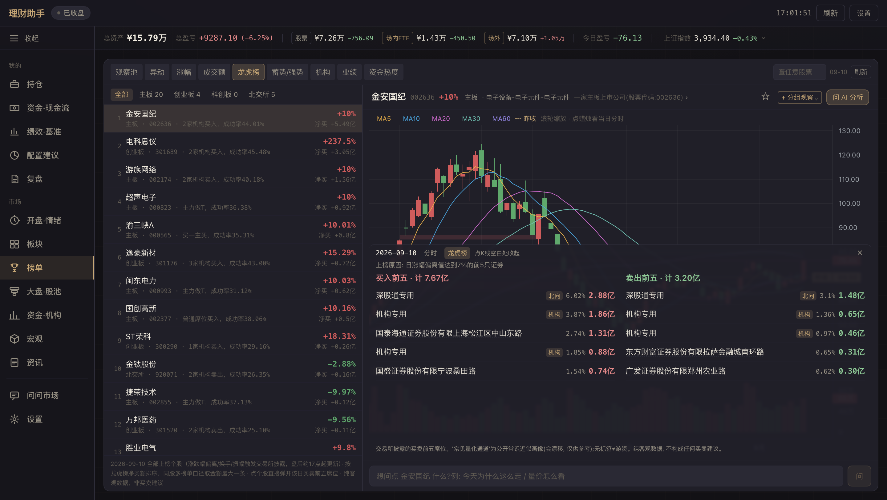

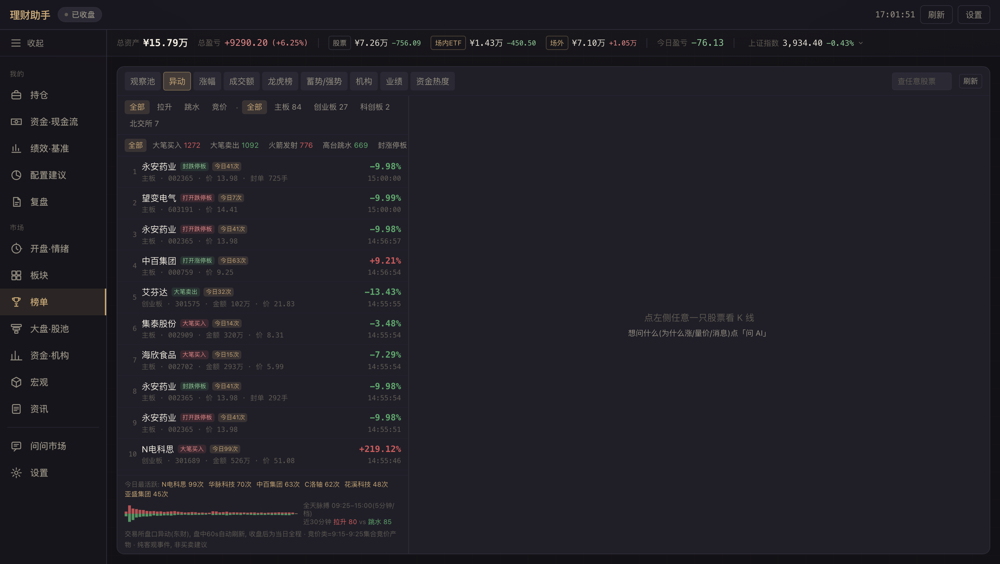

<h3 id="stock-detail">Stock detail</h3>

- **Multi-period K-lines** (day / week / month): moving averages, cost line, volume / MACD / KDJ sub-charts; your own buy and sell points marked to the fill time, with fills of one order merged into one marker; ex-rights and splits normalized to one scale.
- **Chip distribution** (A-share stocks): holding-cost distribution inferred from turnover (Grinblatt & Han 2005), with profit ratio, average cost and the 90% chip range; computed only from loaded bars, with coverage shown.
- **Intraday chart**: price, VWAP, volume colored by aggressor side; zoom, pan and crosshair. "Tick rendering" redraws from full-day ticks to reveal sub-minute price spikes.
- **Level-2 order book** (five levels) and **tick trades**.
- **Company profile**: sub-industry, business summary and revenue breakdown.
- **Panic-exit index** (0–100): scored from the day's drop, close position, volume ratio, breakdown or new low, and losing streak, with its percentile over the last 120 days. Hover shows offline statistics over about 2.63 million stock-days (2019–2026): high scores without a limit-down show no clear difference in subsequent moves; after a limit-down, stocks stay weaker on average.
- **Institutional buying**: net buy, appearance count and change since the last appearance of institutional seats on the dragon-tiger list over 30 days. Only disclosed days are visible, so it is a sample.
- **Entry mirror**: for the stock's current state (today's change, position in its 120-day range, prior 20-day change), how many times you bought in the same state before and what happened in the following 20 days. Uses the same grouping as [entry review](#entry-review).

Intraday, weekly / monthly K-lines, the order book and tick trades require the [TDX data source](#tdx-data-source); without it the detail page offers daily K-lines only.

<h3 id="sectors-and-sentiment">Sectors and sentiment</h3>

- **Sector radar**: each A-share holding versus its Tonghuashun industry (about 90 fine-grained industries), with 60-day excess return.
- **Sector turnover share**: each industry's share of total market turnover, and its change versus the previous day and 5 days ago. Rising share with a falling sector usually means heavy disagreement.
- **Sentiment cycle**: limit-up count, limit-down count, win rate and highest consecutive-limit streak over 30 trading days, overlaid to show the phase of the cycle.

Share and sentiment data are stored locally after each close, so history grows with use.

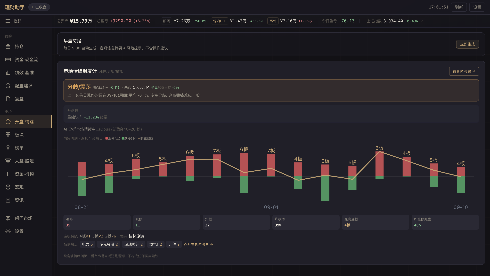

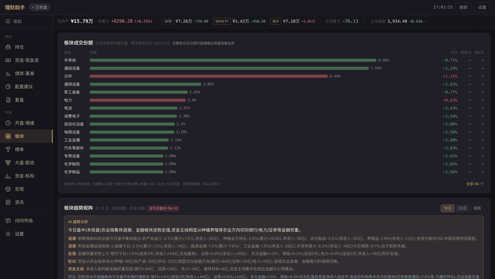

<h3 id="etf-theme-x-ray">ETF theme X-ray</h3>

Checks an ETF's claimed theme against the constituents in its quarterly report and computes a theme-match weight, to catch ETFs whose holdings do not match their names.

- Each stock is judged by its industry, never by its name.
- Funds are classified by name into four types: thematic funds get a match percentage with three warning levels; broad index, style and cross-border / commodity / bond funds only show their industry distribution.
- When a theme is finer than the industry taxonomy (e.g. semiconductor equipment, innovative drugs), the result notes that only the broad category was verified.
- Searching by theme compares only the largest N funds for that theme.

Data comes from quarterly reports and lags to the end of the previous quarter.

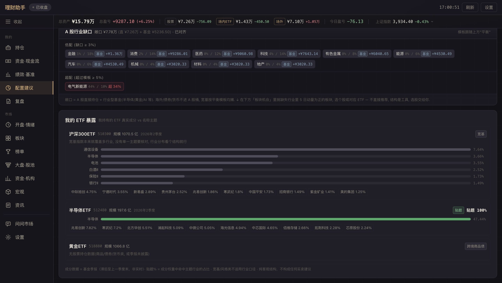

<h3 id="news-and-event-calendar">News and event calendar</h3>

The news page aggregates five sources: global macro flashes, holding-specific news, market headlines, commodities and the event calendar. Items can be filtered to those related to your holdings, including ETF themes.

- **AI commentary**: any item expands into "summary / why it matters / relation to your holdings", answered with your full portfolio as context, commentary only.
- **Event calendar**: scheduled earnings dates, ex-dividend dates and lock-up expiries for A-share holdings, the watchlist and the top-10 constituents of held ETFs.
- **Full-text extraction**: locates the main content by paragraph density; JavaScript-rendered pages fall back to remote rendering.

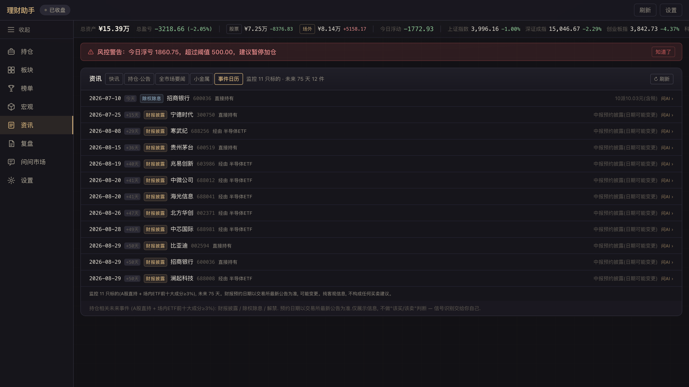

<h3 id="global-index-bar">Global index bar</h3>

The top bar pins one index; click it for K-line and intraday charts and switch among 16 indices.

| Market | Indices | Intraday source | Turnover |
|---|---|---|---|
| A-shares | SSE Composite, SZSE Component, CSI 300, ChiNext, STAR 50, STAR 100, BSE 50 | TDX | Yes |
| Hong Kong | Hang Seng, Hang Seng Tech, HS China Enterprises | Tencent | Yes |
| US | Dow Jones, Nasdaq, S&P 500 | Yahoo 1-minute bars | Share volume only |
| Other | Nikkei 225, KOSPI, FTSE 100 | Sina global | None |

Known issues and verification methods for each source are in the [data-source notes](docs/data-source-notes.md#全球指数分时).

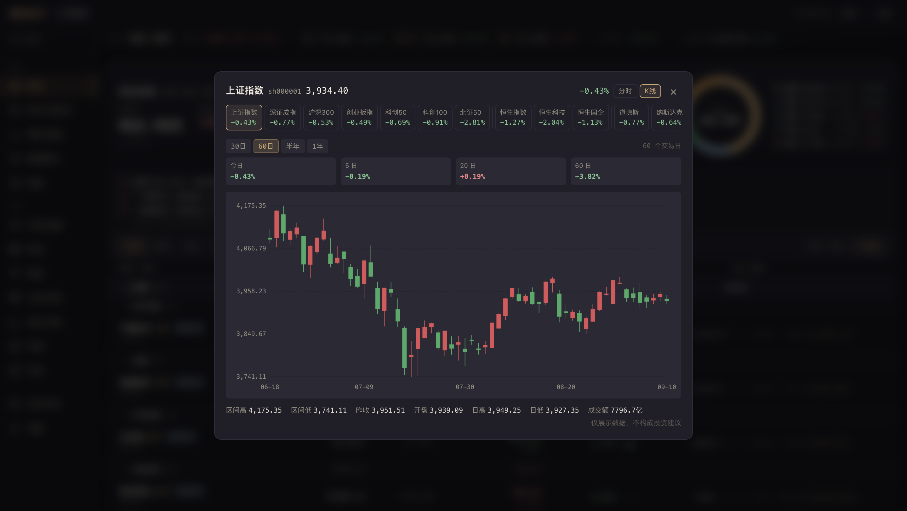

## Briefings and review

<h3 id="morning-briefing-and-close-summary">Morning briefing and close summary</h3>

**Morning briefing** (9:00 on trading days, or on demand): an objective summary and risk notes per holding from recent news, announcements, K-lines and fundamentals. Each holding gets a news tone (warm / neutral / cool / caution), a one-line headline and 2–4 supporting points; earnings, regulatory, insider-selling and technical-breakdown risks are listed separately. ETFs are covered through theme keywords. Requires an [LLM](#llm).

**Close summary** (15:10 on trading days): generated from data without an LLM:

- Portfolio-wide P&L for the day ranked by contribution; OTC funds without a published NAV are estimated from holdings and marked as such.
- Events: holdings or watchlist stocks on the dragon-tiger list, at limit-up or limit-down, or releasing earnings previews.
- Market line: advancers / decliners, limit counts and sentiment.

The summary appears under Review → Today and is pushed to Feishu if configured.

<h3 id="review">Review</h3>

- **Equity curve**: daily portfolio value rebuilt from trades and price history, shown as a time-weighted return (TWR) against the CSI 300 and other benchmarks from a common start; HK and US holdings add Hang Seng, S&P and Nasdaq benchmarks aligned to each market's calendar. Shows period return, maximum drawdown and excess return. Daily closing snapshots calibrate historical value.
- **Correlation matrix**: pairwise daily-return correlation of holdings, and each against the CSI 300.
- **Today's attribution**: portfolio-wide (A-shares, HK/US stocks, funds, digital assets, bots) daily moves with matching news.
- **Period statistics**: win rate, profit/loss ratio, average holding period and intraday round-trip detection; A-shares and funds counted together, splits not counted as trades.
- **AI review**: uses the TWR figures above and that day's look-through exposure to assess consistency with your stated discipline. It evaluates only what already happened.
- **Market overview at close**: limit counts, failed-limit rate, win rate, highest streak, sectors and styles where money concentrated, leaders, inflow ranking and institutional dragon-tiger activity.
- **Holiday context**: within 7 trading days before and 5 after the Spring Festival and National Day holidays, shows days until the break and how the CSI 1000 and SSE Composite behaved around the same holiday in past years.

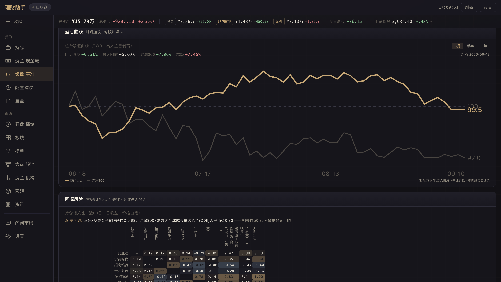

<h4 id="entry-review">Entry review</h4>

Places every active buy back on its K-line, groups buys by the state visible at the previous day's close, and reports actual returns after 5 and 20 trading days.

- **Price state** (stocks and ETFs): buy price versus previous close, previous day's position in its 120-day range, prior 20-day change.
- **Plugin verdicts** (stocks, needs an [analyzer plugin](#analyzer-plugins) implementing the review interface): patterns and risk tier on the day before the buy, next to market-wide statistics for the same group.
- The groups that differ most from all buys are summarized at the top; per-trade detail is expandable.

Conventions: multiple buys of one stock on one day count as one decision; OTC funds are excluded. Fill prices are converted to the forward-adjusted scale using that day's unadjusted close and must fall within the day's high-low range, otherwise the close is used and marked with an asterisk. Groups with fewer than 5 samples are dimmed.

<h2 id="market-qa-agent">Market Q&A agent</h2>

A Q&A agent for questions about stocks and the market, money flows, industry chains, and your own holdings and trades. It chooses and calls data tools in parallel and streams each step as it runs.

**Tool coverage**

| Area | Contents |
|---|---|
| Price action | Real-time quotes with limit-up / limit-down detection, N-day price and volume, single-bar patterns, structure scans (head and shoulders, double tops, triangles, gaps, divergence, false breakouts), multi-period summaries |
| Money flow | Main-force flow, dragon-tiger seats, seat tracking, institutional seats, limit-up sentiment, advance/decline distribution, sector momentum, shareholder structure |
| Fundamentals | Financials for A / HK / US stocks (converted by reporting currency), company profile and controlling shareholder, objective red-flag list (penalties, inquiries, insider selling, lock-up expiries, goodwill) |
| News | Stock news, structured announcements (US via SEC EDGAR with 8-K items explained), macro flashes, web search, full-page reading |
| Your data | Holdings (same prices, values and P&L as the dashboard), trades, cost, realized P&L, days held, today's P&L, look-through exposure, watcher findings |
| Industry chain | For a chain question, finds representative companies per segment online and builds a batch price-volume table |

About 50 base tools; [Knowledge Planet](#knowledge-planet) adds 3 and an [extension data source](#extension-data-sources-provider) adds 4. HK and US stocks are recognized by `HK.` / `US.` prefixes or uppercase US tickers.

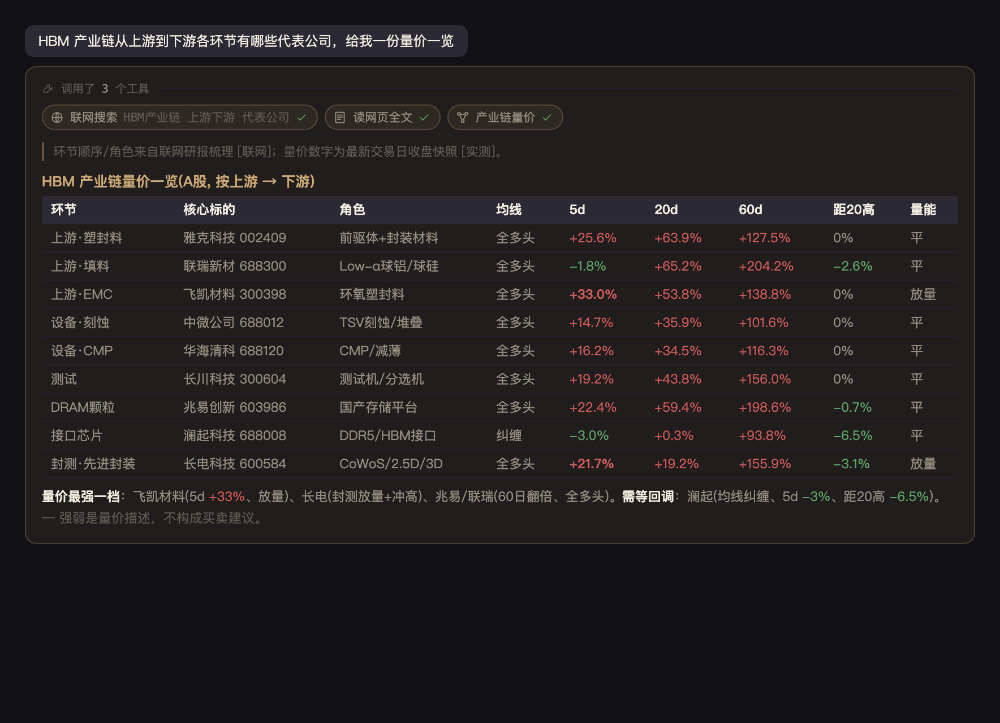

**Answer conventions** (built into the system prompt)

- Price and volume are the primary evidence; money-flow data is supporting evidence, and divergence is stated explicitly.
- Key numbers carry a source tier: `[实测]` local tools, `[联网]` web results with clickable source markers, `[待核实]` unverified; Knowledge Planet content is tagged `[星球观点]` and never used as numeric evidence.
- Recent events are kept apart from background; on non-trading days data is anchored to the latest trading day.
- US pre-market, after-hours and regular-session prices are reported separately.
- Output is objective information only, with no buy, sell, position-size or price-target advice.

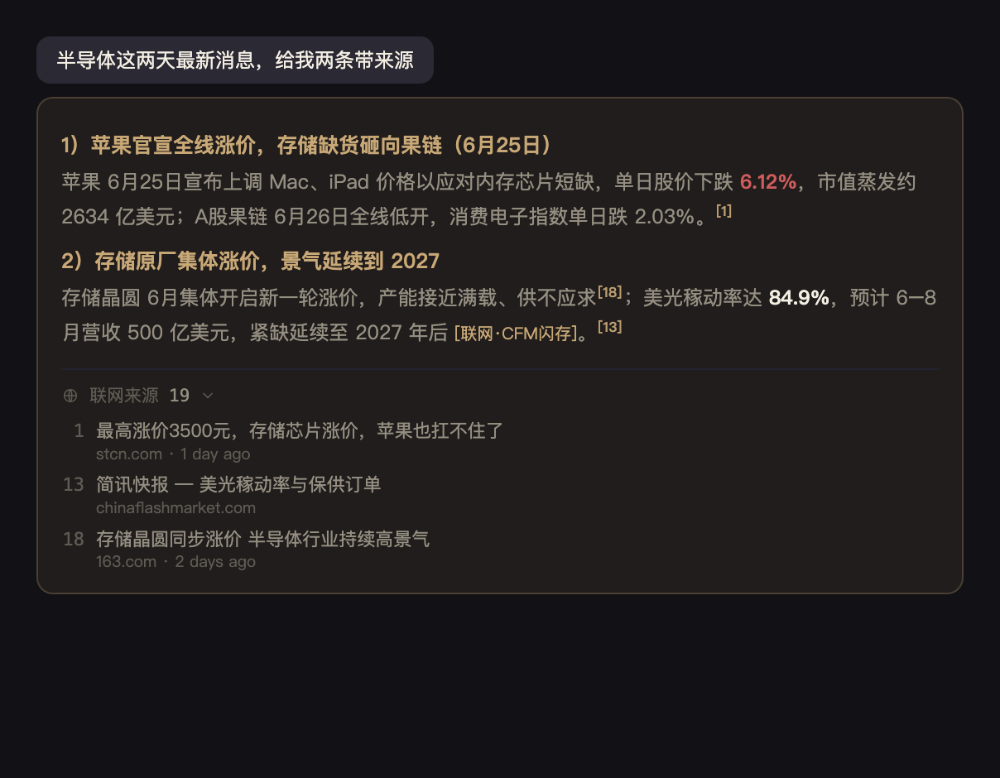

**Conversations and tasks**

- **Server-side runs**: each turn runs on the server; switching pages, closing the drawer or refreshing does not stop it, and the result is saved to history. Run events are persisted, so after a restart an unfinished turn is marked interrupted and its completed steps remain visible.
- **Follow-ups while answering**: the input stays open; additions go to the turn's inbox and are read at the next step. Additions arriving after the answer are merged into a new question automatically.
- **Sub-agents**: the main agent can dispatch sub-agents with separate contexts via `dispatch_tasks`, either in parallel for aggregation or as background tasks whose results return to the conversation as cards.
- **Scheduled tasks**: a query can be scheduled for a later time in conversation. Schedules survive restarts; a background sub-agent runs them on time and posts the result to the original conversation and the watcher panel.
- **Inline components**: "name (code)" in answers opens the stock detail; K-line, intraday and comparison charts render in place.
- **Stock drawer**: any stock can open the same chat panel.

**Quality controls**

| Mechanism | Description |
|---|---|
| Regression evals | Each case comes from a real wrong answer and uses hard assertions computed from live data. `python -m evals.run` runs against the demo database and supports `--cases`, `--shard` and pass^k |
| Answer checks | Deterministic checks before finalizing (US session labels, stale news without web verification, invented index turnover, trading instructions, leaked HTML); a hit triggers a rewrite. Shares its criteria with the eval set |
| Reading rules | Cases where the user corrected the agent are mined from history and drafted into candidate rules and pre-answer checks, every Monday. They take effect only after approval under "AI 读盘规则" in settings (or `python scripts/rules.py`) |
| Tool-gap ledger | Errors, empty results, stale data (by trading day) or all-zero key fields are recorded; `python scripts/tool_gaps.py` shows the summary |
| User memory | The agent can remember preferences and how you refer to things; writes made after reading external text require confirmation, and memories can be reviewed and deleted in settings |

**Safety boundaries**: sub-agents that process third-party text (such as full announcements) can only use tools that query public data by code, with parameters limited to codes, dates and numbers; the text is wrapped in random delimiters and declared non-executable. Tool restrictions apply both when tools are offered and when they are executed.

<h2 id="watcher">Watcher</h2>

The watcher is the proactive layer: detectors run in the background, findings are deduplicated and shown in the watcher panel in the top bar, and the Q&A agent can read them via `get_watch_findings`. Findings stay on the page and are not pushed to Feishu.

| Detector | What it reports | Schedule |
|---|---|---|
| Books drift | Broker available cash differs from ledger cash, suggesting unsynced trades | After close |
| Red flags | Red-flag count on a holding or watchlist stock ≥ 2 and higher than the previous day (needs plugin `risk_flags`) | After close |
| New buys | New A-share buys in the trade log, with outcomes of your past buys in the same state; same-day fills merged | Trading days |
| Late rally / limit close | Last-30-minute gain above a threshold, or closing at limit-up (one-price limits distinguished) | After close |
| VWAP break | A holding rallies above intraday VWAP, then breaks below and stays there | Every minute 10:00–15:00 |
| Lock-up expiry | Expiry within 5 trading days covering ≥ 5% of free float | Trading days |
| Fund estimate miss | Published NAV deviates from the regression estimate by more than 3× the fund's historical error | Daily 9:00–23:00 |
| Fund drawdown | Daily or 5-day decline in the fund's worst 1% / 2% over two years | Daily 9:00–23:00 |
| Announcements | New announcements pre-filtered by keyword, judged by a model, then read in full by a sub-agent; shown only when substantive | Every 30 minutes |

- Each finding has a one-line conclusion, with details collapsed; watchlist findings rank after holdings.
- **Follow-up digging**: new findings pass program rules, then a lightweight model decides whether to investigate; if so, a background sub-agent looks for the cause and attaches it to the finding, or stays silent if nothing is found. "查原因" (find cause) can also be triggered manually.
- **Self-check**: every detector run is recorded (completed / skipped with reason / failed), and missed runs, repeated failures and data anomalies are flagged at the top of the panel.

Books drift requires `watch_cash_cmd` in the local `config.py`: a command that prints the broker's available cash. Because it is executed, it is read only from the local config file and never stored in the database.

<h2 id="optional-integrations">Optional integrations</h2>

Everything below is optional. Without it, the related UI hides itself or explains what is missing, and everything else works as usual.

<h3 id="llm">LLM</h3>

The morning briefing, Q&A agent, AI commentary and AI review need an LLM. The client speaks the Anthropic Messages API and works with the official API or any compatible endpoint.

| Method | Configuration |
|---|---|
| Claude Code OAuth | Install and log in to the Claude Code CLI; credentials are read from the macOS keychain |
| Anthropic API key | `export ANTHROPIC_API_KEY=sk-ant-...` |
| Compatible endpoint | `LLM_BASE_URL`, `LLM_API_KEY`, and as needed `LLM_API_KEY_HEADER`, `LLM_API_KEY_PREFIX`, `LLM_MODEL_MAP` |

These can also be set under "LLM 配置" in settings; precedence is environment variable > settings page > default. The agent uses prompt caching; server overload (429 / 529) is retried with exponential backoff, timeouts are not retried.

<h3 id="network-proxy">Network proxy</h3>

If overseas endpoints (LLM APIs, exchanges, Yahoo) need a proxy, set it under "本地代理" in settings (auto-detection available); LLM requests can also have their own proxy in "LLM 配置" or via `LLM_PROXY`. Domestic data sources connect directly.

<h3 id="notifications-and-exchanges">Feishu notifications and exchange sync</h3>

- **Feishu**: enter the webhook under "飞书 Webhook URL" in settings. Morning briefings, close summaries, trade-plan hits and fundamental warnings are pushed there.
- **Exchange**: enter API key, secret and passphrase under "OKX API 凭证"; read-only permission is recommended. Spot and bot positions sync automatically; the server contains no order-placing code.

<h3 id="tdx-data-source">TDX data source</h3>

Intraday charts, weekly / monthly K-lines, the order book and tick trades rely on a locally deployed TDX (Tongdaxin) market-data protocol server. [SnowWarri0r/tdx-api](https://github.com/SnowWarri0r/tdx-api) is recommended: it fixes market prefixes for some ETFs and the `kline-history` date range, and makes the port configurable. licai always sends explicit `sh` / `sz` / `bj` prefixes, so upstream also works.

```bash
export TDX_BASE_URL=http://localhost:8080    # or tdx_base_url in config.py
```

The log line `TDX 数据源已启用` confirms the connection.

<h3 id="knowledge-planet">Knowledge Planet</h3>

Adds community opinion to the Q&A agent through three read-only tools: recent topics, keyword search, and attachment text (docx / pdf). It connects through Knowledge Planet's official MCP endpoint; `services/mcp_http.py` is a minimal MCP streamable-HTTP client.

Setup: settings → "知识星球" → enter the official MCP endpoint URL → load your planets → select → save.

- **Read-only allowlist**: only read tools are allowed; the generic API tool is limited to `GET` requests for file links.
- **Owner filter**: per planet, off by default.
- **No storage of source text**: content is passed to the model in memory only.
- **Attachments on demand**: read one at a time by `file_id`, size-capped, never bulk-downloaded.
- **Separate credibility tier**: tagged `[星球观点]` with author and date.

The endpoint URL contains an API key, so it is stored only in the local database, displayed and logged in redacted form, and must be `https`.

> Content rights and platform terms are between you and Knowledge Planet. Use your own account and follow each planet's rules.

<h3 id="extension-data-sources-provider">Extension data sources (provider)</h3>

All built-in data sources are public endpoints that need no account. Four kinds of data are only available from commercial terminals and require your own credentials:

| Data | What public sources cover |
|---|---|
| Identity labels for dragon-tiger seats (known traders, quant channels) | Eastmoney gives branch names only; `data/seat_names.json` fills part of the gap |
| Sector-level call-auction events | Order-book events cover stock-level auction events only |
| Quarterly institutional sector changes | Institutional dragon-tiger seats reflect short-term trading only |
| Limit-up history beyond three weeks | Eastmoney's limit-up pool covers about three weeks |

This repository defines the protocol only (`services/providers/base.py`) and ships no implementation. A package implementing it must be explicitly selected in settings after installation:

```bash
pip install -e /path/to/your-provider
# select it under "扩展数据源" in settings, or:
export MARKET_PROVIDER='mypkg.myprovider:Provider'
```

Packages registered in the `licai.providers` entry-point group appear as candidates in settings; listing them reads packaging metadata only and does not import package code. Protocol, capability list and a minimal example are in [docs/providers.md](docs/providers.md).

> Credentials and terms of service are between you and the data provider; judge compliance yourself.

<h3 id="analyzer-plugins">Analyzer plugins</h3>

Providers add data; analyzers add a computation layer on top of daily K-lines. Your own price-volume models, pattern recognition or risk scoring can be packaged as plugins.

| | provider | analyzer |
|---|---|---|
| Purpose | Add a data source | Compute on daily K-lines |
| Active at once | One | Any number |
| Entry-point group | `licai.providers` | `licai.analyzers` |

```bash
pip install -e /path/to/your-analyzer   # register in the licai.analyzers entry-point group; restart to load
export LICAI_ANALYZERS=off              # disable all analyzers, for troubleshooting
```

A plugin declares `name`, `display_name`, `min_bars` and optionally `context_symbols` (index K-lines it needs); `analyze(code, bars, stock_name, live_last, context)` returns a generic display structure (chips, items, timeline, status line and footnotes). Optional interfaces:

- `review_points` / `review_catalog`: historical verdicts and comparison statistics for [entry review](#entry-review).
- `risk_flags`: data for the watcher's red-flag detector.
- `watch_events`: thresholds and historical statistics for the watcher's close events and VWAP break.
- Daily lists: shown on the "Market & pools" page.

The full contract is in the module docstring of `services/analyzers.py`. A failing plugin affects only itself; with no plugins installed, the related UI does not appear.

## Tech stack

- **Backend**: FastAPI, SQLite, akshare, and public endpoints from Sina, Eastmoney, Tonghuashun, Tencent, Yahoo and SEC EDGAR.
- **LLM**: Anthropic Messages API, tool-calling agent with SSE streaming.
- **Frontend**: React, Vite, Tailwind CSS, installable as a PWA.
- **Optional dependencies**: pypdf and python-docx (only for Knowledge Planet attachment text).

The frontend build lives in `static/` and takes effect immediately after rebuilding. Open pages compare their bundle with `/api/app-version` and show a refresh prompt when they differ.

**Security**: data-changing requests are accepted only from the app's own pages; HTTP and WebSocket requests both validate the Host header against DNS rebinding.

## Project layout

<details>
<summary><b>Directory overview</b></summary>

```
licai/
├── api/                    # FastAPI routes (holdings, external assets, market, Q&A, settings, brokers, briefings)
├── services/
│   ├── stock_agent         # Q&A agent: tool definitions and tool-calling loop
│   ├── agent_tasks         # sub-agents and scheduled tasks
│   ├── ask_runs            # server-side lifecycle and event persistence of a Q&A turn
│   ├── agent_guides        # answer guides loaded on demand
│   ├── answer_guard        # deterministic pre-answer checks
│   ├── rule_forge          # drafting reading rules from user corrections
│   ├── user_memory         # user memory
│   ├── watcher             # watcher detectors
│   ├── watch_dig           # watcher follow-up digging
│   ├── watch_health        # watcher self-check
│   ├── position_ledger     # total cost incl. commission, stamp duty, transfer fee
│   ├── trade_fills         # fill merging
│   ├── exposure            # look-through exposure (with as_of)
│   ├── portfolio_risk      # portfolio volatility
│   ├── portfolio_curve     # TWR curve, drawdown, correlation, daily snapshots
│   ├── fund_proxy          # OTC fund top-10 estimate
│   ├── fund_nav_model      # OTC fund regression estimate
│   ├── trade_plan          # trade plans
│   ├── watchlist           # watchlist (groups, batch-add parsing)
│   ├── concept_tags        # concept tag cleaning and synonym merging
│   ├── concept_trend       # concept turnover-share trends (coverage-gated)
│   ├── stock_changes       # order-book event parsing
│   ├── lhb_detail          # dragon-tiger seats, profiles and tracking
│   ├── sentiment_history   # sentiment cycle archive
│   ├── sector_share        # sector turnover-share archive
│   ├── etf_xray            # ETF theme X-ray
│   ├── entry_review        # entry review
│   ├── panic_index         # panic-exit index
│   ├── exright             # ex-rights restoration
│   ├── morning_briefing    # morning briefing
│   ├── eod_summary         # close summary
│   ├── event_calendar      # event calendar
│   ├── market_data         # market data
│   ├── external_assets     # funds, HK/US stocks, digital assets, futures quotes
│   ├── llm_client          # LLM client (multiple endpoints)
│   ├── proxy_config        # network proxy
│   ├── origin_guard        # origin and Host validation
│   ├── mcp_http            # minimal MCP client
│   ├── zsxq_client         # read-only Knowledge Planet access
│   ├── analyzers           # analyzer loading and contract
│   └── providers/          # extension data-source protocol (no implementations)
├── evals/                  # Q&A regression evals
├── frontend/               # React + Vite
├── scripts/                # demo data, reading rules, tool gaps, etc.
├── docs/                   # data-source notes, provider protocol, screenshots
├── config.example.py       # config template
├── database.py             # SQLite schema and data access
└── run.py                  # server entry point
```

</details>

## Contributing

Issues and PRs are welcome. Numbers that disagree with your broker app and small usability problems are often more valuable than new features; please include reproduction steps and the values you saw.

**Development**

Set up as in [Quick start](#quick-start). Use demo data during development and rebuild after frontend changes:

```bash
python scripts/seed_demo.py --use
cd frontend && npm run build
```

Restart `run.py` after Python changes.

**Tests**

```bash
python -m pytest tests/ -q      # backend
cd frontend && npm test         # frontend
```

Both suites run offline in a few seconds; please make sure they pass before opening a PR. Frontend tests cover the pure-function layer (fees, fund classification, exchange vs OTC detection, overlap thresholds, portfolio aggregation and daily P&L); UI interactions still need checking in a browser.

**Conventions**

- Comments explain why, not what; update module docstrings when the logic they describe changes.
- Tests must be verifiable in reverse: reverting the fix should make them fail.
- When adding or changing a data source, cross-check it against a second source and record it in the [data-source notes](docs/data-source-notes.md).
- Statistics based on local caches must report coverage and gate on it, marking themselves unavailable when coverage is insufficient.
- Include screenshots for UI changes.
- Never commit `portfolio.db`, backups or local config.
- User-facing text, prompts and indicator explanations give objective information only; see [Scope and disclaimer](#scope-and-disclaimer).

**Areas to contribute**

- Broker statement import (order contract numbers allow exact fill merging)
- Portfolio metrics (Sharpe ratio, drawdown decomposition, etc.)
- Internationalization and wider market coverage
- Data-convention corrections

## Scope and disclaimer

- This project is a read-only personal asset dashboard. It only displays and analyzes data from the user's own accounts and provides no trade execution, exchange, matching, managed investing or referral features.
- The digital-asset module reads balances and history from the user's own account through a read-only API key only; the server has no order-placing code path (see the module docstring of `services/okx_client.py`).
- All output is objective information and structural description and does not constitute investment advice. Digital-asset business activities are illegal financial activities in mainland China, and personal investment risk is borne by the user; using this tool does not change that legal status.

## Privacy

- All data is stored in local SQLite and never uploaded.
- Public quotes need no account; exchange, LLM and Feishu credentials are stored in the local database.
- `portfolio.db` is in `.gitignore`.
- `backups/` keeps daily backups for the last 30 days.

## Known limitations

- Some Eastmoney endpoints are rate-limited or unreachable on certain networks; Tonghuashun, Sina and Tencent serve as fallbacks, and some modules may be empty while limits last.
- The LibreSSL in macOS's bundled Python 3.9 has unstable TLS handshakes with some endpoints; a curl subprocess is used as a fallback.
- Free data sources have misaligned fields, inconsistent units and discontinued symbols; see the [data-source notes](docs/data-source-notes.md).
- Overseas endpoints (LLM APIs, exchanges, Yahoo) may require your own network setup.

## License

[GNU AGPL-3.0](./LICENSE)

licai is a complete application rather than a library; AGPL requires modified versions offered as a network service to be open-sourced as well. Self-hosting and personal modification are unrestricted.

## Star History

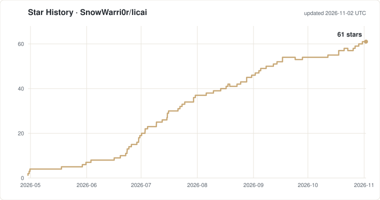

> The star history chart is generated daily by a [GitHub Action](.github/workflows/star-chart.yml) in this repository, with no third-party service.
