<div align="center">


# 理财助手 · licai

**本地运行的个人资产看板与市场分析工具**

A股 · 港美股 · 基金 · 银行理财 · 现金 · 数字资产 · 量化机器人，统一在一个看板中管理；<br>
附带市场问答 agent、盯盘员、全市场榜单、板块与情绪分析、复盘归因

<!-- badge 必须整行写在一起: 源码里换行会被渲染成一个一列, 排不成横排 -->
[](https://github.com/SnowWarri0r/licai/releases) [](./LICENSE) [](https://github.com/SnowWarri0r/licai/stargazers) [](https://github.com/SnowWarri0r/licai/commits/main)

[](https://www.python.org/) [](https://fastapi.tiangolo.com/) [](https://react.dev/) [](https://www.sqlite.org/) [](#技术栈)

数据保存在本机的单个 SQLite 文件中，无云端、无账号体系。<br>
全部输出为客观信息与结构描述，不提供买卖建议。

**中文** · [English](./README.en.md)

<a href="#快速启动"><b>快速启动</b></a> · <a href="#功能概览"><b>功能概览</b></a> · <a href="#问问市场"><b>问问市场</b></a> · <a href="#盯盘员"><b>盯盘员</b></a> · <a href="#可选接入"><b>可选接入</b></a> · <a href="#定位与免责声明"><b>免责声明</b></a>

</div>

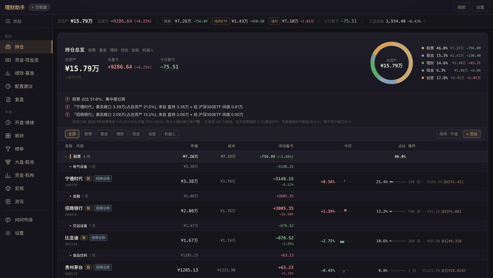

> 截图使用演示数据，可通过 `python scripts/seed_demo.py --use` 复现。

## 项目定位

券商与银行 App 只展示各自平台内的资产，跨平台汇总需要手工完成；表格记账则缺少行情接入与分析能力。licai 将分散在各平台的头寸汇总到同一界面，按统一口径计算成本、盈亏与风险敞口，并在此基础上提供市场数据查询与复盘工具。

设计上遵循三条原则：

- **本地优先**：行情取自公开接口，账本、凭证与配置全部存于本机 SQLite。
- **口径可核对**：成本、手续费、净值估算与券商或基金平台的口径对齐；依赖样本的统计会注明覆盖率，覆盖不足时不给结论。
- **只呈现事实**：面向用户的文案、LLM 输出与提醒均限定为客观信息与历史统计，方向性决策留给使用者。

## 快速启动

```bash
git clone https://github.com/SnowWarri0r/licai
cd licai

# 后端
python3 -m venv venv && source venv/bin/activate
pip install -r requirements.txt
cp config.example.py config.py      # 按需修改佣金率 commission_rate / 最低佣金 commission_min 等

# 前端
cd frontend && npm install && npm run build && cd ..

# 启动
python run.py                       # 访问 http://localhost:8888
```

首次启动会在项目根目录创建空的 `portfolio.db`。请始终使用 `venv` 中的 Python 启动：可选插件通过该环境的入口点加载。

**演示数据**

```bash
python scripts/seed_demo.py --use       # 备份当前数据库并写入演示数据, 重启服务后生效
python scripts/seed_demo.py --restore   # 恢复原数据库
python scripts/seed_demo.py --peek      # 只生成 portfolio.demo.db, 不改动当前数据库
```

**开机自启（macOS）**

```bash
./install.sh    # 由 com.licai.plist.example 生成 launchd 配置并注册, 日志在 logs/
```

**局域网访问**

服务默认监听 `0.0.0.0:8888`。同一网络内的设备可通过 `http://<本机 IP>:8888` 访问；出于防 DNS 重绑定的考虑，服务只接受 IP 地址或 `localhost` 形式的 Host。

## 功能概览

侧栏按「是否与自己的资金相关」分为两组；问问市场与设置位于底部，盯盘员入口在顶栏。

| 分组 | 页面 | 内容 |
|---|---|---|
| 我的 | 持仓 | [全资产看板](#全资产看板)、成交流水、录入表单、交易计划 |
| | 资金·现金流 | 月度收入、支出、净储蓄与可支配预算 |
| | 绩效·基准 | 基准对照、[板块雷达](#板块与情绪)、[组合净值曲线](#复盘)、持仓相关性 |
| | 配置建议 | [模板配比差额](#配置建议)、A 股行业缺口、ETF 暴露 |
| | 复盘 | [今日 / 周 / 月 / 总览复盘](#复盘)、收盘小结、收盘市场全景、[买点回看](#买点回看) |
| 市场 | 开盘·情绪 | [早盘简报](#早盘简报与收盘小结)、情绪温度计与情绪周期 |
| | 板块 | 板块成交份额、趋势矩阵、板块动量、[ETF 题材透视](#etf-题材透视) |
| | 榜单 | [九个页签的全市场榜单](#全市场榜单)、概念轮动板、K 线浮层 |
| | 大盘·股池 | 涨停股次日表现分池、连板梯队、分析插件提供的每日清单 |
| | 资金·机构 | 机构季报增减仓与热门题材（需[扩展数据源](#扩展数据源provider)） |
| | 宏观 | 11 组指标：海内外指数、算力、汇率、有色与贵金属、能源化工、农产品等 |
| | 资讯 | [五源资讯流与 AI 解读](#资讯与事件日历) |
| 底部 | 问问市场 | [市场问答 agent](#问问市场) |
| | 设置 | 飞书推送、本地代理、交易所凭证、LLM 配置、知识星球、扩展数据源、AI 读盘规则、AI 记住的关于你 |

页面使用 hash 路由（如 `#portfolio`、`#rankings`），可直接收藏或分享深链。

## 资产与账本

<h3 id="全资产看板">全资产看板</h3>

| 大类 | 取价与口径 |
|---|---|
| A 股 | 实时行情；综合成本含佣金、印花税、过户费，与券商 App 口径一致 |
| 港美股 | 实时行情、日 K 与分时；按成交日汇率记账，汇总折算人民币；支持拆合股、美股碎股、分红预扣税 |
| 基金 | 场内 ETF 按实时市价与券商佣金计算；场外基金按官方净值，申赎按 T+1 确认，赎回费按持有天数先进先出扣除 |
| 理财 | 银行定期理财，按年化与起投日估算 |
| 现金 | 货币基金与活期余额，可估算月息 |
| 数字资产 | 交易所现货实时价格 |
| 机器人 | 交易所网格 / 定投机器人，自动同步盈亏 |

账本处理的几项口径：

- **份额拆分自动入账**：对比原始与前复权日 K 识别拆分因子，份额乘以 N、单价除以 N，不产生盈亏。
- **摊薄成本**：减仓的已实现盈亏摊入剩余持仓成本，清仓后重置，与券商 App 一致。
- **分笔成交合并**：同一委托的多笔成交按一次决策统计，判据按价格跳档数，见[数据口径档案](docs/data-source-notes.md#一次委托的分笔成交)。
- **多券商**：每笔成交可记录所属券商，按各自费率计算手续费；成交时间可精确到分钟。

看板同时提供大类与子类饼图、集中度提示、[穿透同源风险](#风险提示)，以及四种加仓录入方式（按股数、本金 + 净值、本金 + 份额、待确认）。

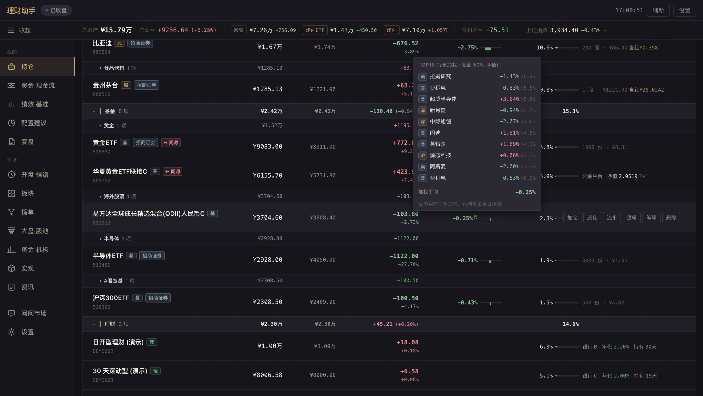

**交易计划**：收盘后为次日设定价位计划，盘中到价时在页面提示（配置飞书时同时推送），收盘后与实际成交对照。

<h3 id="基金净值估算">场外基金盘中估算</h3>

场外基金净值在 T+1 公布，盘中需要估算。licai 提供两层估算：

1. **前十大持仓加权**：取季报前十大持仓股的实时涨跌加权，并标注覆盖的净值比例。
2. **回归估算**：每只基金用最近 120 个净值日，对一组指数与 ETF（沪深300、中证1000、创业板、科创50、恒生、恒生科技、纳指100、标普500、费城半导体、沪金）及前十大加权值做岭回归。有足够历史时替换第 1 层。

近 180 个净值日的离线评估（日涨跌平均绝对误差，单位为百分点）：

| 基金类型 | 前十大加权 | 回归 |
|---|---|---|
| 标普500 指数 QDII | 0.61 | 0.08 |
| 纳指100 指数 QDII | 0.69 | 0.12 |
| 信息科技主动基金 | ~0.98 | ~0.62 |
| 全球科技主动 QDII | 0.8~1.2 | 0.45~0.85 |
| 黄金联接 | 0.25 | 0.26 |

待公布净值日按 A 股交易日历计算：A 股休市而港美股开市的日子，涨跌并入下一个净值日。盘中会为 A 股、港股指数与沪金因子补上当日实时 K 线。模型缓存在 `data/fund_nav_model.json`，拟合失败时回退到前十大加权。


<h3 id="配置建议">配置建议</h3>

保守 / 平衡 / 激进三套模板，按总资产分为四档（< 30 万、30–100 万、100–500 万、> 500 万）。海外配置有开户、汇兑与单笔门槛等固定成本，因此海外比重随资金量上升。ETF 与 QDII 按底层资产归入 10 个类别，页面给出当前与目标配比的差额。以 30–100 万档为例：

| 模板 | 现金 | 理财 | 债基 | A股 | 港股 | 美股 | 其它海外 | 商品 | 加密 |
|---|---|---|---|---|---|---|---|---|---|
| 保守 | 21% | 42% | 16% | 10% | 1% | 5% | 0% | 5% | 0% |
| 平衡 | 22% | 25% | 8% | 20% | 3% | 10% | 2% | 6% | 4% |
| 激进 | 22% | 8% | 5% | 28% | 4% | 14% | 2% | 7% | 10% |

模板约束定义在 `AllocationAdvisor.jsx` 的 `TEMPLATE_MATRIX`：保守档的现金、理财与债基合计 ≥ 60%；平衡档权益与稳健资产各半；激进档权益与加密合计 ≥ 70%。

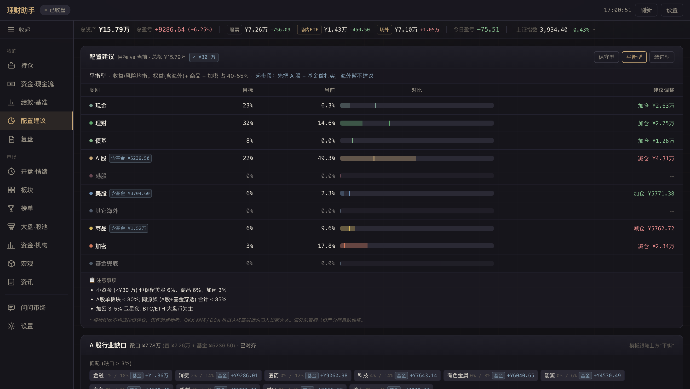

<h3 id="风险提示">风险提示</h3>

风险提示只给出客观度量，不产生操作信号。

- **组合波动**：对 A 股、场内 ETF 与场外基金持仓，用各自近 250 个交易日的日收益做 EWMA 协方差，给出下一交易日与未来 5 个交易日 95% 置信度下的最大亏损金额，以及各持仓对组合方差的贡献。附滚动回测：固定当前持仓，逐日只用此前的数据估算，实际亏损超出估值的比例应接近 5%。加密资产与网格机器人的日收益无法对齐 A 股日历，单独列出。
- **穿透同源**：将基金与 ETF 拆到季报前十大持仓，与直接持有的个股合并，再按行业归并。这样可以发现名称上看不出的重复敞口，例如两只基金前十大高度重叠，或同一只股票经多只 QDII 间接持有。
  - 同一基金的 A / C 份额自动合并。
  - 前十大只覆盖部分净值，因此结果是敞口的下限；拿不到持仓明细的基金单独列出，不按 0 计算。
  - 持仓行上的「同源」角标按穿透后的行业标注；占总资产不足 0.5% 的行不标。
  - 支持回看历史某日（`?as_of=YYYY-MM-DD`）：A 股按账本回放到当天，基金、理财与现金取当天或之前最近一次快照，所用数据日期写在返回的 `basis` 中。
  - 看板提示、`/api/portfolio/exposure` 与 agent 的 `get_exposure` 工具共用同一口径。
- **集中度**：单板块占比超过 50% / 70% 时提示。
- **基本面健康度**：红 / 黄灯标识。

相关性矩阵与穿透同源的区别在于：前者度量走势上的统计相关，后者度量底层持仓的结构重叠。

## 市场

<h3 id="全市场榜单">全市场榜单</h3>

榜单页左侧为列表、右侧为 K 线面板，`↑` `↓` 切换个股，`←` `→` 切换页签。顶部搜索框支持代码、名称与子串查询，可查看任意股票。

| 页签 | 内容 |
|---|---|
| 观察池 | 自建分组管理，一只股票可属于多个分组；显示今日涨跌、加入以来涨跌、K 线结构与业绩预告 |
| 盘口异动 | 交易所 22 类异动事件流，盘中每 60 秒刷新 |
| 涨幅榜 | 按涨幅占涨跌停幅度的比例排序，10% 与 20% 涨跌幅限制的股票可以同榜比较；附概念轮动板 |
| 成交额榜 | 当日成交额排行；附概念轮动板 |
| 龙虎榜 | 最新披露日全部上榜个股，可展开买卖前五席位 |
| 蓄势 / 强势 | 龙头池中结构完好的两类股票，按行业分组 |
| 机构 | 机构专用席位近 30 天买卖统计 |
| 业绩 | 最新报告期业绩预告，标注与持仓的关联 |
| 资金热度 | 全市场人气排行，持仓标注「持」 |

<details>
<summary><b>观察池</b></summary>

- 分组为顶层视图：全部 / 持仓 / 各自建分组 / 自选。
- 「自选」是默认分组：通过星标加入时默认放入此组；股票移出最后一个分组时回到此组。批量操作时每只股票最多保留 8 个分组。
- 每个分组独立保存组内排序，可拖动调整。
- 持仓作为虚拟分组自动并入，显示浮盈与持有天数，清仓后消失。
- **批量编辑**：勾选多只（Shift 连选）后加入分组、移到分组、移出本组或移出观察池，后端在单个事务内完成。
- **批量添加**：粘贴一段文本，解析出 A 股与场内基金代码（可带 `sh`、`.SZ` 等前后缀）、港股代码、美股代码及完整股票名称。未能确定的条目列出候选供选择，确认后一次加入指定分组。已在池中的股票保留原加入日期与价格。

</details>

<details>
<summary><b>概念轮动板</b></summary>

涨幅榜与成交额榜顶部的常驻面板，将上榜个股按概念聚合，用于观察资金在哪些概念之间移动。

- 每个概念一行：上榜数与涨停数、成交额、平均涨幅、成交份额近五日走势、较上一交易日的变化、领涨个股。
- 点击概念可筛选左侧榜单；面板可折叠为一行摘要。
- 结论基于成交份额而非绝对成交额，全市场放量时依然可比。
- **标签清洗**：剔除融资融券、指数成分、地域等全市场普遍存在的标签，保留产业链与供应链概念。
- **同义合并**：成分股高度重叠的概念按 Jaccard 相似度合并为一行，阈值依据见[数据口径档案](docs/data-source-notes.md#概念标签)。
- **覆盖率闸门**：走势基于本地日线缓存计算。单个概念成分不足 3 只或覆盖不足一半时不绘制走势，整榜覆盖不足三成时整体不出结论，并在界面说明原因。

</details>

<details>
<summary><b>盘口异动 · 龙虎榜 · 蓄势 / 强势</b></summary>

**盘口异动**：事件按拉升 / 跳水 / 竞价分组，组内可按类型细分。每行显示按事件类型解析的关键幅度（涨速、封单、大单金额）与当日触发次数。底部给出全天最活跃个股、5 分钟粒度的拉升 / 跳水分布与近 30 分钟计数。

**龙虎榜**：按净买额排序，点击展开当日买卖前五席位与席位画像（机构、北向、知名席位、量化通道）。席位名号表位于 `data/seat_names.json`，可自行维护。点击席位名可查看该营业部近 90 天的上榜明细与上榜后 1 / 5 / 10 日表现。

**蓄势 / 强势**：池子为百亿市值、有机构持仓且盈利的龙头股。

- 强势：距 60 日高点 ≤ 12%，近 10 日无大阴线，上行结构未破坏，不跑输沪深300。
- 蓄势：窄幅、缩量、横盘 ≥ 45 日，规则筛选后由 AI 看图复核。

以上均为结构描述，不代表后续走势。

</details>

**K 线浮层**：可缩放蜡烛图，含成交量、MA5/10/20/30/60、昨收线、跳空缺口与悬浮涨跌幅。点击任意 K 线可打开当日分时（支持逐笔精绘）与龙虎榜席位。历史分时的昨收基准按分红送配明细逐事件做除权还原，避免前复权 K 线与真实成交价之间的错位。

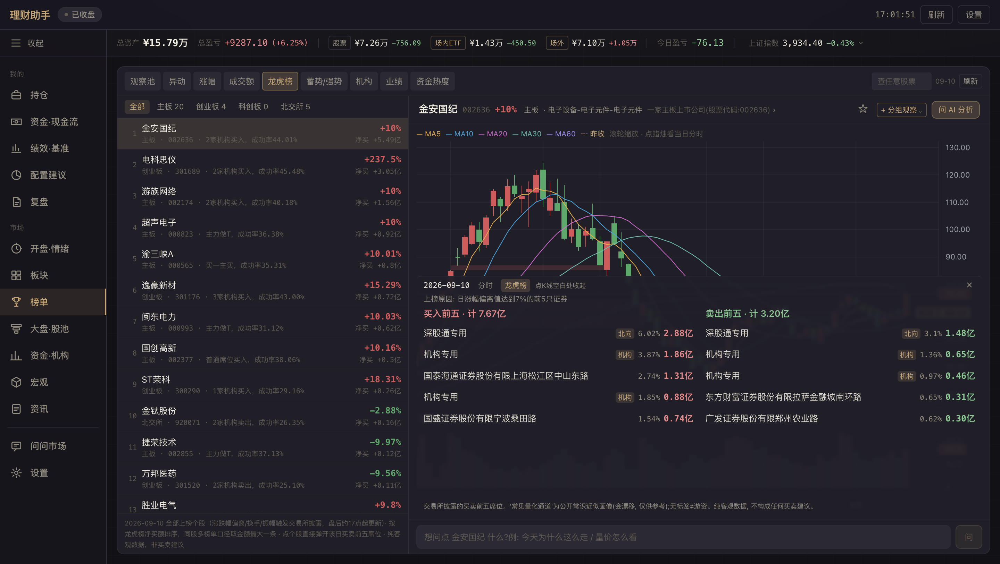

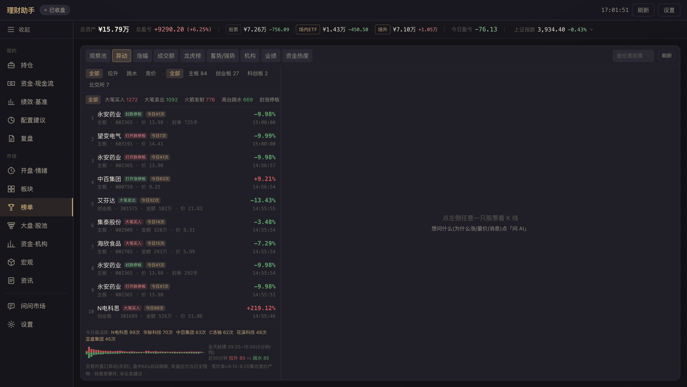

<h3 id="个股详情">个股详情</h3>

- **多周期 K 线**（日 / 周 / 月）：MA 均线、成本线、成交量 / MACD / KDJ 副图；标注本人的买卖点（精确到成交时刻，同一委托的多笔成交合并为一个标记）；除权与份额拆分折算到同一标度。
- **筹码分布**（A 股个股）：按换手率推算持仓成本分布（Grinblatt & Han 2005），显示获利比例、平均成本与 90% 筹码区间；只统计已加载的 K 线，并标注覆盖比例。
- **当日分时**：价格、均价、主动买卖着色的成交量；支持缩放、平移与十字光标。「逐笔精绘」改用全天逐笔数据绘制，可还原分钟内的瞬时价格尖峰。
- **五档盘口**与**逐笔成交**。
- **公司简介**：细分行业、主营业务与主营构成。
- **恐慌逃离指数**（0–100）：依据当日跌幅、收盘位置、量比、是否破位或创新低、连跌天数计算，并给出其在近 120 日中的分位。悬停可查看全市场 2019–2026 年约 263 万个股票日的离线统计：非跌停的高分日之后，后续走势与普通日无明显差异；跌停之后平均持续偏弱。
- **机构进货**：近 30 天龙虎榜机构专用席位的净买额、上榜次数与最近上榜后的涨跌。仅反映上榜日，属于抽样数据。
- **买入前对照**：按该股当前状态（当日涨跌、120 日区间位置、前 20 日涨跌），列出本人历史上同类状态下的买入次数与之后 20 日的实际结果。与[买点回看](#买点回看)使用相同的分组口径。

分时、周 / 月 K 线、五档盘口与逐笔成交依赖[通达信数据源](#通达信数据源)；未启用时详情页只提供日 K。

<h3 id="板块与情绪">板块与情绪</h3>

- **板块雷达**：每只 A 股持仓与其所属同花顺行业（约 90 个细分行业）对比，给出 60 日超额收益。
- **板块成交份额**：各行业成交额占全市场的比重排行，以及较上一交易日与 5 日前的份额变化。份额上升而板块下跌，通常对应放量分歧。
- **情绪周期**：近 30 个交易日的涨停数、跌停数、赚钱效应与最高连板高度叠加显示，用于判断情绪所处阶段。

份额与情绪数据在每个交易日收盘后写入本地数据库，历史随使用时间累积。

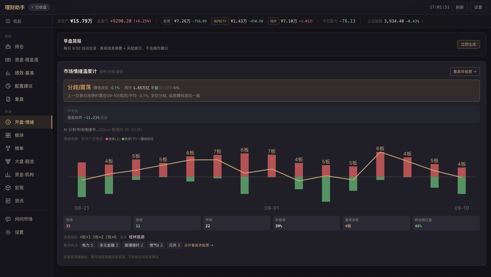

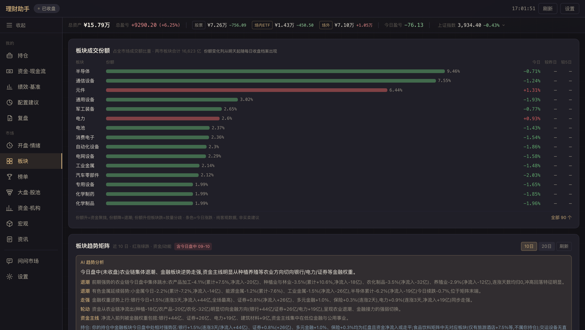

<h3 id="etf-题材透视">ETF 题材透视</h3>

用基金季报的成分股核对 ETF 名称所宣称的主题，计算主题匹配权重，用于识别名不副实的 ETF。

- 逐股判定只依据所属行业，不依据股票名称。
- 基金按名称自动分为四类：行业主题类计算贴题比例并分三档提示；宽基、风格策略与跨境商品债类只展示行业分布。
- 当主题比行业分类更细（如半导体设备、创新药）时，注明只验证到大类。
- 按主题查询时，只对比该主题规模最大的前 N 只。

数据来自基金季报，滞后至上一季度末。

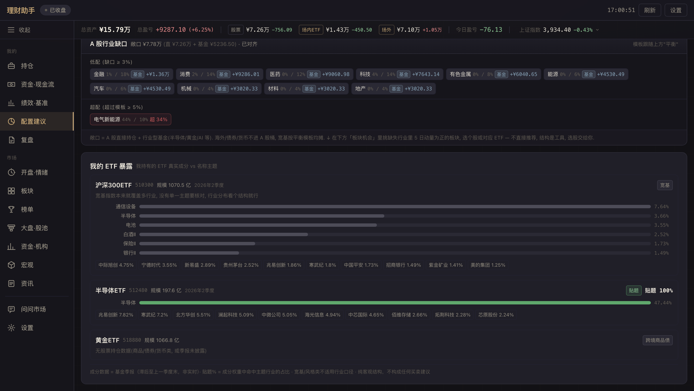

<h3 id="资讯与事件日历">资讯与事件日历</h3>

资讯页聚合五个来源：全球宏观快讯、持仓个股新闻、市场要闻、商品产业与事件日历。可筛选与持仓相关的条目（关联词覆盖场内 ETF 的主题）。

- **AI 解读**：任意一条可展开为「内容概要 / 重要性 / 与持仓的关系」三段，结合全部持仓作答，只解读不给建议。
- **事件日历**：财报预约披露日、除权除息与限售解禁，覆盖 A 股持仓、观察池与场内 ETF 的前十大成分股。
- **原文抓取**：按段落密度定位正文容器；JS 渲染页面自动改用远端渲染。

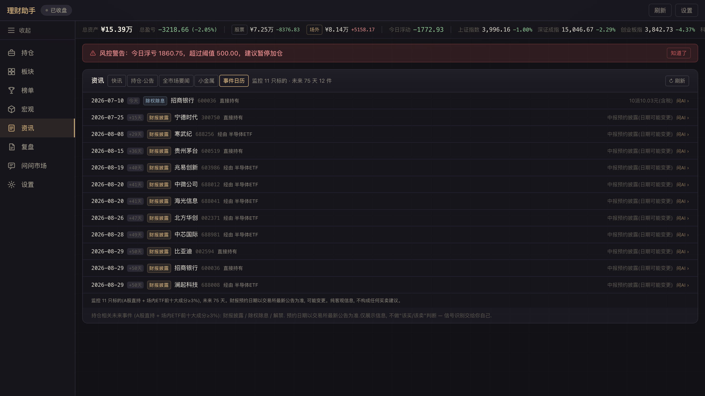

<h3 id="全球指数条">全球指数条</h3>

顶栏可选择一个指数常驻显示，点击后展开 K 线与分时，面板内可切换 16 个指数。

| 市场 | 指数 | 分时来源 | 成交额 |
|---|---|---|---|
| A 股 | 上证、深成、沪深300、创业板、科创50、科创100、北证50 | 通达信 | 有 |
| 港股 | 恒生、恒生科技、恒生国企 | 腾讯 | 有 |
| 美股 | 道琼斯、纳斯达克、标普500 | Yahoo 1 分钟线 | 仅成交股数 |
| 其他 | 日经225、韩国 KOSPI、伦敦 FTSE | 新浪环球 | 无 |

各数据源的已知问题与校验方法见[数据口径档案](docs/data-source-notes.md#全球指数分时)。

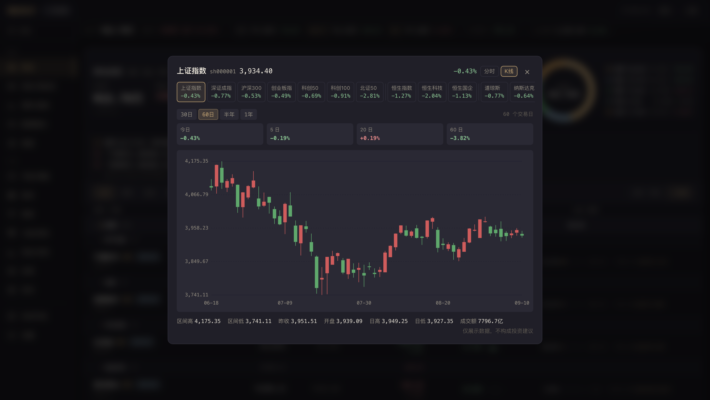

## 简报与复盘

<h3 id="早盘简报与收盘小结">早盘简报与收盘小结</h3>

**早盘简报**（交易日 9:00，可手动触发）：基于每只持仓近期的新闻、公告、K 线与基本面，生成客观摘要与风险提示。每只持仓给出消息面倾向（偏暖 / 中性 / 偏冷 / 警惕）、一句话要点与 2–4 条依据，业绩、监管、减持、技术破位等风险单独列出。场内 ETF 按主题词检索消息。需要配置[大模型](#大模型)。

**收盘小结**（交易日 15:10）：不经过大模型，由数据直接生成：

- 全组合当日浮动盈亏按贡献排序；场外基金净值未公布时按底层估算并标注。
- 事件：持仓或观察池上龙虎榜、涨跌停、当日披露业绩预告。
- 大盘：涨跌家数、涨跌停数与情绪定性。

小结在复盘页「今日」中展示，配置飞书时同时推送。

<h3 id="复盘">复盘</h3>

- **组合净值曲线**：由成交流水与历史行情逐日重建组合市值，计算时间加权收益（TWR），与沪深300 等基准同起点对比；港美股持仓自动加入恒指、标普、纳指基准，并按各市场交易日对齐。给出区间收益、最大回撤与超额收益。每日收盘快照用于校准历史市值。
- **持仓相关性矩阵**：持仓两两之间及与沪深300 的日收益相关系数。
- **今日归因**：全组合口径（A 股、港美股、基金、数字资产、机器人）的当日变动与对应消息。
- **周期统计**：胜率、盈亏比、平均持有天数、做 T 识别；A 股与基金一并统计，份额拆分不计为买卖。
- **AI 复盘**：引用上述 TWR 数据，结合当日的穿透同源结构，按使用者的资金形态评价纪律一致性。只评价已发生的过程。
- **收盘市场全景**：涨跌停家数、炸板率、赚钱效应、最高连板、资金集中的板块与风格、领涨样本、吸金榜与机构龙虎榜。
- **长假前后提示**：春节与国庆前 7 个、节后 5 个交易日内显示距休市天数，以及中证1000 与上证指数在同一假期历年的节前、节后表现分布。

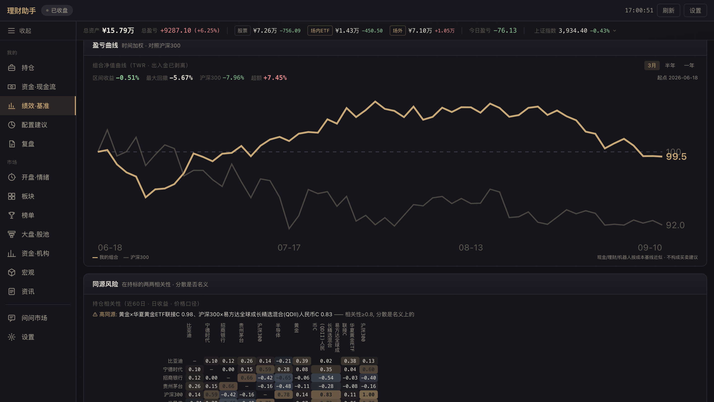

<h4 id="买点回看">买点回看</h4>

将每一笔主动买入放回当时的 K 线，按买入前一交易日收盘时可见的状态分组，统计之后第 5 与第 20 个交易日的实际涨跌。

- **价格状态**（个股与场内 ETF）：买入价相对前收的涨幅、前一日在近 120 日区间的位置、此前 20 日涨跌。
- **插件判定**（个股，需安装实现了复盘接口的[分析插件](#分析插件analyzer)）：买入前一日命中的形态与风险档位，并列全市场同类统计。
- 页面顶部列出与全部买入差异最大的几组；底部可展开逐笔明细。

口径说明：同一股票同一天的多笔买入计为一次决策；场外基金不纳入。成交价换算到前复权标度时使用当天不复权收盘价，换算后需落在当日高低区间内，否则改用收盘价并加注星号。样本少于 5 次的分组淡化显示。

<h2 id="问问市场">问问市场</h2>

市场问答 agent，可查询个股与市场行情、资金、产业链及本人的持仓与成交。agent 自行选择并并行调用数据工具，回答以流式方式展示每一步的工具调用。

**工具覆盖**

| 维度 | 内容 |
|---|---|
| 行情与走势 | 实时报价（含涨跌停与炸板判断）、近 N 日 K 线量价、单根形态、结构形态扫描（头肩、双顶、三角收敛、缺口、量价背离、假突破）、多周期摘要 |
| 资金 | 主力资金流、龙虎榜席位明细、席位追踪、机构席位动向、打板情绪、涨跌分布、板块动量矩阵、筹码与股东结构 |
| 基本面 | 财务指标（A 股 / 港股 / 美股，估值按财报币种换算）、公司画像与实控背景、客观风险清单（处罚、问询、减持、解禁、商誉等） |
| 消息 | 个股新闻、结构化公告（美股走 SEC EDGAR，按 8-K Item 编号说明事件类型）、宏观快讯、联网搜索、网页全文读取 |
| 本人数据 | 持仓（与看板同一口径的现价、市值、浮盈）、成交流水、成本、已实现盈亏、持有天数、当日盈亏、穿透敞口、盯盘员发现 |
| 产业链 | 查询某条产业链时，联网整理各环节代表公司，并生成批量量价一览表 |

基础工具约 50 个；接入[知识星球](#知识星球)增加 3 个，接入[扩展数据源](#扩展数据源provider)增加 4 个。港美股可通过 `HK.`、`US.` 前缀或美股大写代码识别。

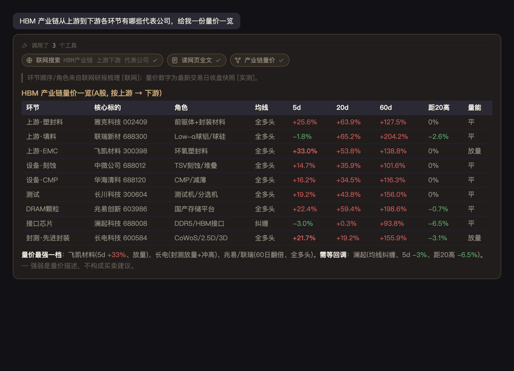

**作答规范**（固化在系统提示中）

- 以 K 线与成交量为主要依据，资金流数据作为参考，二者背离时明确指出。
- 关键数字标注来源等级：`[实测]` 本地工具、`[联网]` 搜索结果（附可点击的来源角标）、`[待核实]` 未经工具验证；知识星球内容标 `[星球观点]`，不作为数字依据。
- 区分近期事件与背景信息；非交易日的行情锚定到最近交易日。
- 美股的盘前、盘后与正常时段价格分别表述。
- 只输出客观信息，不给买卖、仓位或目标价建议。

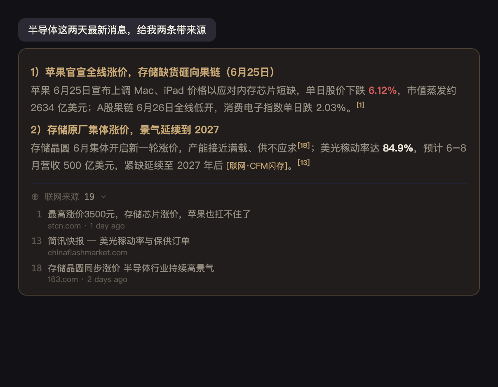

**对话与任务**

- **服务端执行**：每一轮在服务端独立运行，切换页面、关闭抽屉或刷新不会中断，完成后写入历史；过程事件落盘，服务重启时未完成的轮次标记为中断，再次打开可看到已完成的步骤。
- **回答期间可补充**：输入框不锁定，补充内容进入本轮收件箱，agent 在下一步读取；回答完成后才到达的补充会合并成新问题继续。
- **子 agent**：主 agent 可通过 `dispatch_tasks` 派出独立上下文的子 agent，或并行拆解后汇总，或作为后台任务在完成后以卡片形式回到会话。
- **预约任务**：可在对话中约定在指定时间执行查询，服务重启后保留，到点由后台子 agent 执行，结果进入原会话并在盯盘员面板记录。
- **答案内组件**：回答中的「名称（代码）」可点击打开详情，K 线、分时与对比图可就地渲染。
- **个股抽屉**：任意个股可唤起与问问市场相同的对话面板。

**质量保障**

| 机制 | 说明 |
|---|---|
| 回归评测集 | 每个用例来自一次实际答错，用实时数据计算硬断言后判定回答。`python -m evals.run` 默认针对演示库运行，支持 `--cases`、`--shard` 与 pass^k |
| 答案自检 | 定稿前做确定性检查（美股时段、旧新闻未联网核实、编造指数成交额、出现交易指令、漏出 HTML 等），命中则要求重写；与评测集共用判据 |
| 读盘规则 | 从历史对话中提取「用户纠正」的案例，起草为候选规则与出答案前的检查项。每周一自动提取，在设置页「AI 读盘规则」中逐条批准后才生效（也可使用 `python scripts/rules.py`） |
| 工具缺口台账 | 工具返回错误、空值、过期数据（按交易日计）或关键字段全为 0 时记录，`python scripts/tool_gaps.py` 查看汇总 |
| 画像记忆 | agent 可记住使用者的偏好与称呼；读取过外部文本后的写入需人工确认，可在设置页查看与删除 |

**安全边界**：处理第三方原文（如公告全文）的子 agent 只能使用按代码查询公开数据的工具，参数限定为代码、日期与数字；原文以随机分隔符包裹并声明其中的指令不予执行。工具限制在定义下发与执行两层同时生效。

<h2 id="盯盘员">盯盘员</h2>

盯盘员是主动提醒层：各检测器在后台运行，发现经去重后显示在顶栏的盯盘员面板中，问答 agent 也可通过 `get_watch_findings` 读取。提醒只在页面展示，不推送到飞书。

| 检测器 | 内容 | 运行时间 |
|---|---|---|
| 账实核对 | 券商可用资金与账本现金不一致，提示有成交未同步 | 收盘后 |
| 排雷命中 | 持仓或观察池的排雷命中数 ≥ 2 且较上一交易日增加（需插件提供 `risk_flags`） | 收盘后 |
| 新买入对照 | 成交流水中新出现的 A 股买入，附本人历史同类买入的后续结果；同日多笔合并为一条 | 交易日 |
| 尾盘拉升 / 收盘封板 | 持仓或观察池尾盘 30 分钟涨幅超过阈值，或收盘封涨停（区分一字板） | 收盘后 |
| 均价线跌破 | 持仓盘中冲高到分时均价线上方后跌破并持续 | 10:00–15:00 每分钟 |
| 临近解禁 | 5 个交易日内解禁且占流通市值 ≥ 5% | 交易日 |
| 基金估值偏差 | 净值公布后与回归估值的偏差超过该基金历史误差的 3 倍 | 每天 9:00–23:00 |
| 基金异常跌幅 | 单日或 5 日累计跌幅落在该基金近两年最差的 1% / 2% | 每天 9:00–23:00 |
| 公告 | 持仓与观察池的新公告按关键词初筛，模型判断是否值得阅读，子 agent 读取原文；读出实质内容才显示 | 每 30 分钟 |

- 每条提醒附一句结论，明细与依据默认折叠；观察池的提醒排在持仓之后。
- **深挖**：新发现先经程序规则筛选，再由轻量模型判断是否需要查原因；需要时派后台子 agent 查询，查到的原因附在该条发现下，查不到则不显示。也可手动点击「查原因」。
- **自检**：每个检测器每次运行都记录结果（完成 / 跳过及原因 / 出错），并检查该运行而未运行、连续出错与数据异常。存在异常时在面板顶部提示。

账实核对需要在本机 `config.py` 的 `watch_cash_cmd` 中配置一条输出券商可用资金的命令。该命令会被执行，因此只从本机配置文件读取，不存入数据库。

<h2 id="可选接入">可选接入</h2>

以下功能均为可选，不配置时对应界面自动隐藏或给出说明，其余功能不受影响。

<h3 id="大模型">大模型</h3>

早盘简报、问问市场、AI 解读与 AI 复盘需要大模型。客户端遵循 Anthropic Messages API 协议，支持官方 API 与兼容该协议的第三方端点。

| 方式 | 配置 |
|---|---|
| Claude Code OAuth | 安装并登录 Claude Code CLI，服务自动从 macOS 钥匙串读取凭证 |
| Anthropic API key | `export ANTHROPIC_API_KEY=sk-ant-...` |
| 兼容端点 | `LLM_BASE_URL`、`LLM_API_KEY`，以及按需设置 `LLM_API_KEY_HEADER`、`LLM_API_KEY_PREFIX`、`LLM_MODEL_MAP` |

以上各项也可在设置页的「LLM 配置」中填写，优先级为环境变量 > 设置页 > 默认值。问答 agent 启用了提示缓存；服务端过载（429 / 529）时按指数退避重试，超时不重试。

<h3 id="网络代理">网络代理</h3>

访问境外接口（模型 API、交易所、Yahoo）需要代理时，在设置页的「本地代理」中填写（支持自动探测），大模型请求也可在「LLM 配置」中单独设置代理，或使用 `LLM_PROXY` 环境变量。国内数据源直连。

<h3 id="通知与交易所">飞书通知与交易所同步</h3>

- **飞书**：在设置页的「飞书 Webhook URL」中填写地址。早盘简报、收盘小结、交易计划到价与基本面预警会推送到飞书。
- **交易所**：在设置页的「OKX API 凭证」中填写 API Key、Secret 与 Passphrase，建议只授予读取权限。现货与机器人持仓自动同步；服务端不包含任何下单代码。

<h3 id="通达信数据源">通达信数据源</h3>

分时、周 / 月 K 线、五档盘口与逐笔成交依赖本地部署的通达信行情协议服务。推荐使用 [SnowWarri0r/tdx-api](https://github.com/SnowWarri0r/tdx-api)，它修复了部分场内 ETF 的市场前缀、`kline-history` 的日期范围，并支持配置端口。licai 的请求都显式携带 `sh` / `sz` / `bj` 前缀，因此也兼容上游版本。

```bash
export TDX_BASE_URL=http://localhost:8080    # 或在 config.py 中设置 tdx_base_url
```

启动日志出现 `TDX 数据源已启用` 即表示接通。

<h3 id="知识星球">知识星球</h3>

为问答 agent 补充社群观点。接入后增加三个只读工具：读取最近主题、按关键词搜索、读取附件正文（docx / pdf）。通过知识星球官方 MCP 端点接入，`services/mcp_http.py` 实现了最小的 MCP streamable-HTTP 客户端。

配置路径：设置页「知识星球」→ 填写官方 MCP 端点 URL → 读取星球列表 → 勾选 → 保存。

- **只读白名单**：只放行读取类工具；通用接口只允许 `GET` 请求获取文件直链。
- **可按星主筛选**：每个星球可单独设置，默认关闭。
- **原文不入库**：内容只在内存中传给模型。
- **附件按需读取**：只按 `file_id` 单份读取，有大小上限，不批量下载。
- **单独的可信度等级**：内容标注 `[星球观点]` 与作者、日期。

端点 URL 含 API key，因此只存于本机数据库，界面与日志只显示脱敏后的地址，且只接受 `https`。

> 内容版权与平台条款由使用者与知识星球之间约定。请使用本人账号并遵守所在星球的规则。

<h3 id="扩展数据源provider">扩展数据源（provider）</h3>

项目自带的数据源均为无需账号的公开接口。以下四类数据只有商业终端提供，需要使用者凭自己的账号接入：

| 数据 | 公开数据源的覆盖范围 |
|---|---|
| 龙虎榜席位身份标签（知名游资、量化通道） | 东财只提供营业部名称，`data/seat_names.json` 可补充部分 |
| 板块级集合竞价异动 | 盘口异动只有个股级竞价事件 |
| 机构季报行业增减仓 | 龙虎榜机构席位只反映短线 |
| 三周以上的涨停历史 | 东财涨停池约覆盖最近 3 周 |

本仓库只定义协议（`services/providers/base.py`），不附带任何实现。实现协议的包安装后需在设置页显式选择才会启用：

```bash
pip install -e /path/to/your-provider
# 在设置页「扩展数据源」中选择, 或:
export MARKET_PROVIDER='mypkg.myprovider:Provider'
```

在 `licai.providers` 入口点组中登记的包会出现在设置页的候选列表中；列出候选时只读取打包元数据，不导入包代码。协议、能力清单与最小实现示例见 [docs/providers.md](docs/providers.md)。

> 凭证与服务条款由使用者与数据源之间约定，请自行判断合规性。

<h3 id="分析插件analyzer">分析插件（analyzer）</h3>

provider 补充数据，analyzer 在已有日 K 上增加一层计算。可将自己的量价模型、形态识别或风险评分做成插件挂载。

| | provider | analyzer |
|---|---|---|
| 用途 | 补充数据源 | 基于日 K 计算 |
| 启用数量 | 一个 | 不限 |
| 入口点组 | `licai.providers` | `licai.analyzers` |

```bash
pip install -e /path/to/your-analyzer   # 登记到 licai.analyzers 入口点组, 重启生效
export LICAI_ANALYZERS=off              # 整体停用, 用于排查问题
```

插件声明 `name`、`display_name`、`min_bars`，可选 `context_symbols`（需要的指数日 K）；`analyze(code, bars, stock_name, live_last, context)` 返回通用展示结构（标签、条目、时间线、状态行与脚注）。可选接口：

- `review_points` / `review_catalog`：为[买点回看](#买点回看)提供历史判定与对照统计。
- `risk_flags`：为盯盘员的排雷命中提供数据。
- `watch_events`：为盯盘员的收盘事件与均价线跌破提供阈值与历史统计。
- 每日清单：在「大盘·股池」页展示。

完整约定见 `services/analyzers.py` 模块说明。单个插件出错只影响其自身；未安装插件时，相关界面不显示。

## 技术栈

- **后端**：FastAPI、SQLite、akshare，以及新浪、东方财富、同花顺、腾讯、Yahoo、SEC EDGAR 等公开接口。
- **大模型**：Anthropic Messages API 协议，tool-calling agent + SSE 流式输出。
- **前端**：React、Vite、Tailwind CSS，支持以 PWA 形式安装。
- **可选依赖**：pypdf、python-docx（仅用于知识星球附件正文提取）。

前端构建产物位于 `static/`，重新构建后立即生效。已打开的页面会将自身 bundle 与 `/api/app-version` 比对，不一致时在右下角提示刷新。

**安全**：修改数据的请求只接受来自本应用页面的来源；HTTP 与 WebSocket 均校验 Host，防止 DNS 重绑定。

<details>
<summary><b>数据源清单</b></summary>

- A 股行情：新浪 `hq.sinajs.cn`；历史 K 线与行业：新浪、东方财富；东财限流时由腾讯与新浪兜底
- 基金净值与持仓：天天基金
- ETF 题材透视：东财场内 ETF 列表、基金季报持仓（akshare）、全 A 行业快照
- 港股、美股、商品期货：新浪
- 指数分时：A 股走通达信，港股走腾讯，美股走 Yahoo，日经 / KOSPI / FTSE 走新浪环球
- 行业板块：同花顺（akshare）
- 资金流、龙虎榜、涨跌家数、概念、财务、公告、业绩预告：东方财富（含 akshare 封装）
- 板块成交份额与情绪档案：同花顺板块汇总、东财涨停池，逐日写入本地
- 盘口异动：东财盘口异动事件流（22 类）
- 除权还原：东财分红送配明细
- 美股资讯与公告：Yahoo 新闻与相关标的、SEC EDGAR
- 网页全文：Firecrawl 免 key 接口为主、Jina Reader 为备用
- 数字资产：交易所公开行情与只读私有接口
- 可选：通达信协议服务、知识星球 MCP、扩展数据源插件

各数据源的字段与单位问题及交叉校验记录见[数据口径档案](docs/data-source-notes.md)。

</details>

## 项目结构

<details>
<summary><b>目录说明</b></summary>

```
licai/
├── api/                    # FastAPI 路由(持仓、外部资产、市场、问答、设置、券商、简报等)
├── services/
│   ├── stock_agent         # 问答 agent: 工具定义与 tool-calling 循环
│   ├── agent_tasks         # 子 agent 与预约任务
│   ├── ask_runs            # 一轮问答的服务端生命周期与事件落盘
│   ├── agent_guides        # 按需加载的作答规范
│   ├── answer_guard        # 定稿前的确定性检查
│   ├── rule_forge          # 从用户纠正中起草读盘规则
│   ├── user_memory         # 画像记忆
│   ├── watcher             # 盯盘员检测器
│   ├── watch_dig           # 盯盘员深挖(模型判定 + 子 agent 查原因)
│   ├── watch_health        # 盯盘员自检
│   ├── position_ledger     # 综合成本(含佣金、印花税、过户费)
│   ├── trade_fills         # 分笔成交合并
│   ├── exposure            # 穿透同源敞口(支持 as_of 回看)
│   ├── portfolio_risk      # 组合波动估计
│   ├── portfolio_curve     # TWR 净值曲线、回撤、相关性、每日快照
│   ├── fund_proxy          # 场外基金前十大加权估算
│   ├── fund_nav_model      # 场外基金回归估算
│   ├── trade_plan          # 交易计划
│   ├── watchlist           # 观察池(分组、批量添加解析)
│   ├── concept_tags        # 概念标签清洗与同义合并
│   ├── concept_trend       # 概念成交份额走势(带覆盖率闸门)
│   ├── stock_changes       # 盘口异动解析
│   ├── lhb_detail          # 龙虎榜席位、画像与追踪
│   ├── sentiment_history   # 情绪周期档案
│   ├── sector_share        # 板块成交份额档案
│   ├── etf_xray            # ETF 题材透视
│   ├── entry_review        # 买点回看
│   ├── panic_index         # 恐慌逃离指数
│   ├── exright             # 除权还原
│   ├── morning_briefing    # 早盘简报
│   ├── eod_summary         # 收盘小结
│   ├── event_calendar      # 事件日历
│   ├── market_data         # 行情接口
│   ├── external_assets     # 基金、港美股、数字资产、期货报价
│   ├── llm_client          # 大模型客户端(多端点)
│   ├── proxy_config        # 网络代理
│   ├── origin_guard        # 来源与 Host 校验
│   ├── mcp_http            # 最小 MCP 客户端
│   ├── zsxq_client         # 知识星球只读接入
│   ├── analyzers           # 分析插件加载与约定
│   └── providers/          # 扩展数据源协议层(不含实现)
├── evals/                  # 问答回归评测集
├── frontend/               # React + Vite
├── scripts/                # 演示数据、读盘规则、工具缺口等脚本
├── docs/                   # 数据口径档案、provider 协议、截图
├── config.example.py       # 配置模板
├── database.py             # SQLite schema 与数据访问
└── run.py                  # 服务入口
```

</details>

## 参与贡献

欢迎提交 Issue 与 PR。与券商 App 对不上的数字、使用中不便的细节，通常比新功能更有价值；提交 Issue 时请附上复现步骤与看到的数值。

**开发环境**

安装步骤同[快速启动](#快速启动)。开发时建议使用演示数据，并在修改前端后重新构建：

```bash
python scripts/seed_demo.py --use
cd frontend && npm run build
```

修改 Python 代码后需重启 `run.py`。

**测试**

```bash
python -m pytest tests/ -q      # 后端
cd frontend && npm test         # 前端
```

两侧测试均离线运行，数秒内完成，提交 PR 前请确保全部通过。前端测试覆盖纯函数层（费率、基金归类、场内外判定、同源门槛、组合聚合与当日盈亏口径），界面交互仍需在浏览器中验证。

**约定**

- 注释说明原因而非行为；修改逻辑时同步更新模块说明中的判据。
- 测试需可反向验证：撤销修复后测试应失败。
- 新接入或修改数据源时，用第二个来源交叉校验，并在[数据口径档案](docs/data-source-notes.md)中记录。
- 依赖本地缓存的统计需报告覆盖率并设置闸门，覆盖不足时标记为不可用。
- 界面改动请附截图。
- 不要提交 `portfolio.db`、备份文件或本机配置。
- 面向用户的文案、提示词与指标解读只提供客观信息，见[定位与免责声明](#定位与免责声明)。

**可参与的方向**

- 券商对账单导入（对账单中的委托合同号可用于精确合并分笔成交）
- 组合分析指标（夏普比率、回撤分解等）
- 国际化与更多市场覆盖
- 数据口径纠错

## 定位与免责声明

- 本项目是个人自用的只读资产看板，功能限于展示与分析使用者自有账户的数据，不提供交易执行、兑换、撮合、代客理财或推广引流功能。
- 数字资产模块只通过只读 API Key 读取使用者自有账户的余额与历史，服务端不包含下单代码路径（见 `services/okx_client.py` 模块说明）。
- 全部输出为客观信息整理与结构描述，不构成投资建议。数字资产相关业务活动在中国境内属于非法金融活动，个人投资风险自担；使用本工具不改变上述法律状态。

## 数据隐私

- 所有数据存于本地 SQLite，不上传云端。
- 公开行情无需账号；交易所、大模型与飞书凭证存于本机数据库。
- `portfolio.db` 已列入 `.gitignore`。
- `backups/` 目录自动保留最近 30 天的每日备份。

## 已知限制

- 东方财富部分接口会限流或在某些网络下不可达，已提供同花顺、新浪、腾讯等备用源，限流期间部分模块可能暂时为空。
- macOS 系统自带 Python 3.9 使用的 LibreSSL 与部分接口握手不稳定，已通过 curl 子进程兜底。
- 免费数据源存在字段错位、单位不一致与停更等问题，处理方式见[数据口径档案](docs/data-source-notes.md)。
- 境外接口（大模型 API、交易所、Yahoo）需自行处理网络访问。

## License

[GNU AGPL-3.0](./LICENSE)

本项目是完整应用而非库，选择 AGPL 以要求基于本项目提供网络服务的修改版同样开源。自行部署与个人修改不受限制。

## Star History

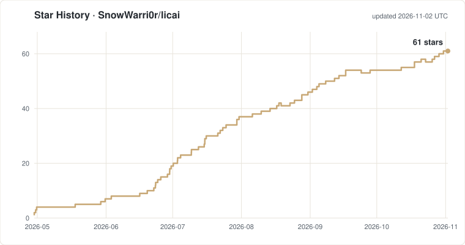

> 星标历史图由仓库内的 [GitHub Action](.github/workflows/star-chart.yml) 每日生成，不依赖第三方服务。
